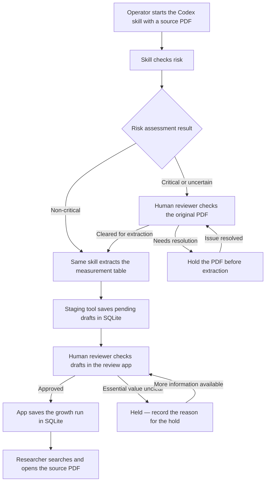

# Design Document: Local Growth Log MVP

## Overview

The Local Growth Log MVP turns existing Drive growth-log PDFs into a searchable, human-approved crystal-growth archive running entirely on the operator's laptop. The operator invokes the `stage-log-runs` Codex skill on selected PDFs. The skill assesses each PDF for extraction risk, automatically calls the local staging tool's `risk-assess` command after producing the risk packet, routes critical or uncertain PDFs to a human reviewer for clearance, and extracts run data only from cleared PDFs. After producing the extraction packet the skill automatically calls `stage-drafts`. There is no manual JSON upload step. A review app lets any lab-authorized reviewer inspect each draft against the source PDF, correct fields, hold runs with a reason, or approve them. Only approved runs are searchable. Search returns approved runs and opens the source PDF at the relevant measurement row.

The MVP runs on a single laptop. It does not make automated model API calls, does not support shared hosting, does not handle researcher photo uploads, and does not include offline sync features. Iris signs off on the MVP test results before wider batch processing begins.

---

## Architecture

The MVP has four components that run locally on the operator's laptop: the Codex skill runner (the user's ChatGPT subscription), the staging tool (a Python CLI tool), the review app (a local web application), and a SQLite database.



### Components

**Codex skill (`stage-log-runs`).** The operator invokes `$stage-log-runs` in their ChatGPT interface with a source PDF. The skill reads the source PDF, produces a versioned risk JSON packet, and immediately calls the staging tool's `risk-assess` command to record the decision. When the PDF is cleared for extraction the skill produces a versioned extraction JSON packet and immediately calls `stage-drafts`. There is no manual JSON upload step. The skill never writes directly to SQLite; all persistence goes through the staging tool. If the staging tool is unavailable the skill saves the completed packet, reports the blocker to the operator, and stops — it never claims drafts were staged without a confirmed staging tool result. The skill checks the stored assessment result for the exact PDF version before starting extraction and will not extract from a PDF whose decision is `critical` or `uncertain` unless a human clearance is recorded.

**Staging tool (Python CLI).** A local command-line tool that accepts a JSON packet path and the SQLite database path. It validates the packet, checks preconditions against the database, and writes records in a single transaction. The current prototype in `pilot/sqlite/pilot.py` covers only the pilot schema and must be extended to the full MVP schema (see [Implementation Gaps](#implementation-gaps)).

**Review app (local web application).** A local app that displays pending draft runs alongside their source PDFs. Lab-authorized reviewers use it to verify, correct, hold, or approve runs. The app reads from and writes to the same SQLite database as the staging tool. It does not make model calls.

**SQLite database.** A single binary file on the operator's laptop that stores source PDF metadata, draft runs, approved runs, revision history, and processing status. The pilot prototype uses a different schema and must be replaced (see [Implementation Gaps](#implementation-gaps)).

### Data flow summary

```
Drive PDF
  → Codex skill (risk assessment)
  → risk JSON packet → skill calls risk-assess automatically
  → source_pdfs row registered + processing_status row in SQLite
  [if critical/uncertain → human clearance recorded in processing_status]
  → Codex skill (extraction, same PDF version)
  → extraction JSON packet → skill calls stage-drafts automatically
  → draft_runs rows staged as Pending review in SQLite
  → Review app (reviewer verifies, corrects, holds, or approves)
  → growth_runs + run_revisions rows in SQLite (on approval)
  → Search index (growth_log_index view or equivalent)
```

---

## Components and Interfaces

### Codex skill: `stage-log-runs`

The **operator** is the lab member who starts or resumes `stage-log-runs`.

The operator invokes `$stage-log-runs` in Codex with a source PDF. The skill is a Codex prompt, not a local CLI tool.

**Inputs:** A source PDF path (or Drive reference) and optional operator-supplied context (e.g. a clearance note).

**Outputs:** A risk JSON packet written to the selected workspace, and — when the PDF is cleared — an extraction JSON packet. After producing each packet the skill calls the corresponding staging tool command directly:

- After the risk packet: `python staging.py risk-assess <packet.json> <database.sqlite>`
- After the extraction packet: `python staging.py stage-drafts <packet.json> <database.sqlite>`

The skill uses the staging tool's exit code and output to confirm that records were staged. It reports the staging tool result to the operator. If the staging tool is unavailable or returns an error, the skill saves the completed packet, reports the blocker, and stops. It never claims drafts were staged without a confirmed successful staging tool result.

The skill reads the extraction gate condition from the instructions and enforces it; the staging tool enforces it again independently.

---

### Staging tool CLI

A local Python command-line tool. It accepts a packet path and a SQLite database path and runs validation and staging in a single transaction.

**Interface:**

```
python staging.py risk-assess <packet.json> <database.sqlite>
python staging.py stage-drafts <packet.json> <database.sqlite>
```

Returns exit code `0` on success, `1` on validation failure or conflict. Prints the number of rows staged on success, or a descriptive error message on failure.

---

### Review App

A local web application (no internet required). The operator and reviewer access it via a browser on the laptop. It reads from and writes to the same SQLite database as the staging tool.

**Key routes (conceptual):**

```
GET  /status                   # processing status per PDF
GET  /drafts                   # pending and held drafts
GET  /drafts/<draft_id>        # draft detail with source PDF viewer
POST /drafts/<draft_id>/hold   # hold with reason
POST /drafts/<draft_id>/approve # approve (reviewer only)
GET  /runs                     # approved runs (search)
GET  /runs/<run_id>            # run detail with revision history
POST /runs/<run_id>/revise     # initiate a correction (reviewer only)
```

Approval and revision require a lab-authorized reviewer, and the app records who took the action. It never makes model calls.

---

### SQLite Database

A single file on the operator's laptop. All components read from and write to this file. The staging tool is the only writer for risk assessments and draft staging. The review app is the only writer for approvals, holds, and corrections.

**Access pattern:**

- Staging tool: writes `source_pdfs`, `draft_runs`, `processing_status`.
- Review app: reads all tables; writes `draft_runs` (hold/approve status), `growth_runs`, `run_revisions`.
- Search: reads `growth_runs` and `run_revisions` only.

---

## Data Models

The data models below correspond to the five MVP tables. Full column specifications are in [SQLite Schema](#sqlite-schema).

### SourcePDF

Represents one version of a growth-log PDF.

```
SourcePDF {
  pdf_id:           string   -- internal primary key; derived on registration
  archive_filename: string   -- display label, e.g. "log-1-042.pdf"; not the version identity
  drive_file_id:    string   -- Drive identifier; together with file_hash identifies the version
  file_hash:        string   -- SHA-256 of the exact PDF bytes; together with drive_file_id identifies the version
  storage_path:     string   -- local path to retained copy
}
```

A replaced Drive file produces a new `SourcePDF` row. The old row is kept so previous approvals remain traceable.

---

### DraftRun

Represents one staged extraction draft awaiting reviewer action.

```
DraftRun {
  draft_id:              string   -- matches draft_id from extraction packet
  pdf_id:                string   -- FK → SourcePDF
  source_locations_json: string   -- [{pdf_index, row}, ...]
  original_json:         string   -- extraction fields as imported; never modified
  review_status:         string   -- "Pending review" | "Held" | "Approved"
  hold_reason:           string?  -- required when status is "Held"
  updated_at:            string   -- ISO timestamp
}
```

---

### GrowthRun

Represents one approved experimental run. Written only by the approval transaction.

```
GrowthRun {
  run_id:                string   -- internal primary key
  pdf_id:                string   -- FK → SourcePDF
  researcher_name:       string?  -- at least one of name/date/jc required
  growth_date:           string?  -- YYYY-MM or YYYY-MM-DD
  date_precision:        string?  -- "day" | "month"
  jc_number:             string?  -- as written; may be null; may repeat
  growth_process:        string?  -- "CVT" | "Flux Growth" | "unclear"
  composition_json:      string?  -- {formula, ratios, weights, units}
  source_locations_json: string   -- [{pdf_index, row}, ...]; at least one required
  details_json:          string?  -- furnace steps, sketch refs, process evidence
}
```

---

### RunRevision

Records one approved version of a run, including correction history.

```
RunRevision {
  revision_id:          string   -- internal primary key
  run_id:               string   -- FK → GrowthRun
  version:              integer  -- monotonically increasing per run_id
  approved_values_json: string   -- snapshot of all fields at approval time
  changes_json:         string?  -- [{field, old_value, new_value, reason}, ...]
  edited_by:            string?  -- null if approved without edits
  edited_at:            string?  -- ISO timestamp; null if no edits
  approved_by:          string   -- required
  approved_at:          string   -- ISO timestamp; required
}
```

---

### ProcessingStatus

Tracks risk assessment and extraction outcome per PDF version.

```
ProcessingStatus {
  pdf_id:        string   -- FK → SourcePDF
  file_hash:     string   -- matches SourcePDF.file_hash
  status:        string   -- "risk_assessed" | "held_pending_clearance" |
                           --  "cleared" | "extraction_complete" | "technical_failure"
  risk_decision: string?  -- "non_critical" | "critical" | "uncertain"
  issues_json:   string?  -- [{reason, source_location}, ...]
  clearance_by:  string?  -- reviewer who recorded clearance
  clearance_at:  string?  -- ISO timestamp of clearance
  clearance_note:string?  -- reviewer's resolution note
  reason:        string?  -- hold or failure description
  updated_at:    string   -- ISO timestamp of last change
}
```

---

## JSON Packet Format

Both risk and extraction packets share a common envelope. The staging tool rejects any packet that does not conform.

### Common envelope fields

| Field | Type | Description |
|---|---|---|
| `schema_version` | integer | Initially `1`. The staging tool rejects packets with an unsupported version. |
| `stage` | string | `"risk"` or `"extraction"`. |
| `drive_file_id` | string | The Drive file ID of the source PDF. Together with `file_hash`, identifies the exact PDF version. `risk-assess` uses these two fields to register the version in `source_pdfs` and assigns an internal `pdf_id`. |
| `file_hash` | string | Hash of the exact PDF bytes processed. The staging tool matches this against `source_pdfs.file_hash` to confirm the same PDF version. |
| `model` | string | Model identifier used for this run (e.g. `"gpt-6.1-sol"`). |
| `prompt_version` | string | Identifier of the prompt template used (e.g. `"stage-log-runs-v1"`). |

### Risk packet additional fields

| Field | Type | Description |
|---|---|---|
| `decision` | string | `"non_critical"`, `"critical"`, or `"uncertain"`. |
| `issues` | array | Zero or more issue objects. An empty array means no issues were found. |

Each issue object contains:

| Field | Type | Description |
|---|---|---|
| `reason` | string | Human-readable description of the issue. |
| `source_location` | object or null | Page index and row (1-based) in the measurement table when the location is known; `null` when no location can be established. |

### Extraction packet additional fields

| Field | Type | Description |
|---|---|---|
| `runs` | array | One entry per growth run extracted from the PDF. |

Each run entry contains:

| Field | Type | Description |
|---|---|---|
| `draft_id` | string | A packet-local identifier for this draft (e.g. `"draft-log1-p3-r2"`). Stable across retries for the same PDF version and measurement-table row. |
| `source_locations` | array | One or more objects, each with `pdf_index` (1-based position in the source PDF) and `row` (1-based data row in the measurement table, skipping the header). |
| `fields` | object | Extracted field values keyed by field name (see below). |

### Extraction field keys

The `fields` object uses exactly these keys:

`researcher_name`, `growth_date`, `jc_number`, `composition`, `furnace_cycle`, `furnace_layout`, `growth_process`, `timestamps`, `measurements`

Each field is an object with:

| Sub-field | Type | Description |
|---|---|---|
| `status` | string | One of the values listed below. |
| `raw_value` | string or null | The text as written in the source PDF. |
| `value` | any or null | Normalized or structured representation. `null` for unknown values. |
| `evidence` | string | Source location, calculation basis, or explanation of why the value is unavailable. |

### Field status values

| Status | Meaning |
|---|---|
| `recorded` | Direct transcription of a written value. |
| `inferred` | Value determined from context (e.g. carry-down, timestamp fallback). |
| `derived` | Value calculated from other recorded values (e.g. moles from masses). |
| `missing` | Inspected but no value found. |
| `unreadable` | Writing is present but cannot be interpreted. |
| `ambiguous` | Multiple plausible readings; human review required. |
| `omitted` | Field was not assessed by the extractor. |

### Dates and JC numbers

Dates use `YYYY-MM` or `YYYY-MM-DD` at the precision the source supports. JC numbers are stored as text exactly as written to preserve partial numbers and leading zeros.

---

## Staging tool

The staging tool is a local Python CLI tool. It accepts a path to a JSON packet and a path to the SQLite database, then validates and stages the packet contents.

### Validation rules

The staging tool checks the following before writing anything to the database:

1. **Schema version.** `schema_version` must be present and equal to a supported version (initially `1`). An unsupported version is a technical failure.
2. **Required envelope keys.** `stage`, `drive_file_id`, `file_hash`, `model`, and `prompt_version` must all be present and non-empty strings.
3. **Source PDF match.** For extraction packets (`stage-drafts`), the staging tool looks up the `drive_file_id` and `file_hash` combination in `source_pdfs` to find the registered `pdf_id`; if no matching row exists, the packet is rejected (see [Unknown PDF version](#unknown-pdf-version)). For risk packets (`risk-assess`), the row may not yet exist and will be created by `risk-assess` as part of the same transaction.
4. **Stage-specific fields.** Risk packets must have `decision` and `issues`. Extraction packets must have a `runs` array.
5. **Decision value.** For risk packets, `decision` must be `"non_critical"`, `"critical"`, or `"uncertain"`.
6. **Extraction precondition.** For extraction packets, the staging tool checks `processing_status` for the registered `pdf_id` resolved from the packet's `drive_file_id` and `file_hash`. It will stage drafts only if the recorded decision is `non_critical` or if a human clearance is recorded. If neither condition is met, the packet is rejected with a clear message and no rows are written.
7. **Field contract.** Each run in an extraction packet must have `draft_id`, `source_locations`, and a `fields` object containing all required keys with valid `status` values.

### Staging logic

**Risk packets.** On first call for a given `drive_file_id` and `file_hash`, `risk-assess` upserts a row in `source_pdfs` to register the exact PDF version, then upserts a row in `processing_status` recording the `decision`, the full issues array, and `updated_at`. Both writes happen in a single transaction. A retry with the same `drive_file_id` and `file_hash` reuses the existing `source_pdfs` row and updates `processing_status` only if the decision has changed. A packet carrying the same `drive_file_id` but a different `file_hash` represents a replacement — the Drive file's bytes have changed. `risk-assess` always creates a new `source_pdfs` row and a fresh `processing_status` row for it. If the previous version was held, clearance does not carry over; the replacement needs its own clearance. `risk-assess` does not write to `draft_runs` or `growth_runs`.

**Extraction packets.** For each run in the packet, the staging tool checks whether a `draft_runs` row already exists for the same `pdf_id`, `file_hash`, and `draft_id`. If none exists, it inserts a new row with status `Pending review`. If one exists with identical JSON content, it skips the row (idempotent retry). If one exists with different JSON content, it surfaces a conflict error and rolls back the entire batch.

**stage-drafts queuing.** `stage-drafts` stages eligible runs as `Pending review` in `draft_runs`. Runs staged by `stage-drafts` appear in the review app immediately. The staging tool never writes to `growth_runs`; only reviewer approval does that.

### Transaction semantics

The entire import of a packet runs in a single SQLite transaction. A malformed packet, a failed validation check, or a conflict error causes a full rollback. No partial writes occur. After a successful commit, the staging tool prints the number of rows staged.

### Idempotency

An identical retry of a previously imported packet stages zero new rows and exits successfully. The operator can safely replay a saved packet without duplicating database entries. A packet with the same `draft_id` but changed content is a conflict and is rejected; the operator must resolve the conflict before reprocessing.

### Conflict detection

When a changed extraction packet references an existing `draft_id` for the same PDF version, the staging tool reports a conflict with the `draft_id` and both JSON payloads for operator review. No rows are modified. If the new packet covers a different PDF version (different `file_hash`), it is treated as a new extraction and may create new draft rows, but a reviewer must confirm the match between old and new drafts before any approved records change.

---

## SQLite Schema

The MVP uses a five-table schema. The pilot prototype schema (`growth_logs` table and `growth_log_index` view in `pilot/sqlite/schema.sql`) does not match this design and must be replaced. See [Implementation Gaps](#implementation-gaps).

### `source_pdfs`

One row per version of a growth-log PDF.

| Column | Type | Notes |
|---|---|---|
| `pdf_id` | TEXT PRIMARY KEY | Internal primary key; assigned on first registration. |
| `archive_filename` | TEXT NOT NULL | Display label shown in the archive (e.g. `log-1-042.pdf`). Not used to identify the PDF version. |
| `drive_file_id` | TEXT | The Drive file ID for the original PDF. Together with `file_hash`, identifies the exact PDF version. |
| `file_hash` | TEXT NOT NULL | Hash of the exact PDF bytes (SHA-256). Together with `drive_file_id`, identifies the exact PDF version. A replaced Drive file (same `drive_file_id`, different `file_hash`) produces a new `source_pdfs` row. |
| `storage_path` | TEXT | Path to the retained copy on the laptop when needed to preserve the exact PDF version. |

### `draft_runs`

One row per staged extraction draft. Only reviewer approval writes a run to `growth_runs`.

| Column | Type | Notes |
|---|---|---|
| `draft_id` | TEXT PRIMARY KEY | Internal primary key; matches the `draft_id` from the extraction packet. |
| `pdf_id` | TEXT NOT NULL | Foreign key to `source_pdfs`. |
| `source_locations_json` | TEXT NOT NULL | JSON array of `{pdf_index, row}` objects. |
| `original_json` | TEXT NOT NULL | The original extraction fields as received from the staging tool. Never overwritten. |
| `review_status` | TEXT NOT NULL | `Pending review`, `Held`, or `Approved`. |
| `hold_reason` | TEXT | Populated when `review_status` is `Held`; records the reviewer's stated reason and source location when available. |
| `updated_at` | TEXT | ISO timestamp of the last status change. |

### `growth_runs`

One row per approved experimental run. Rows are written only by the approval transaction.

| Column | Type | Notes |
|---|---|---|
| `run_id` | TEXT PRIMARY KEY | Internal primary key. |
| `pdf_id` | TEXT NOT NULL | Foreign key to `source_pdfs`. Several runs can point to the same PDF. |
| `researcher_name` | TEXT | Supports lookup; at least one of `researcher_name`, `growth_date`, or `jc_number` is required. |
| `growth_date` | TEXT | ISO date at day or month precision (`YYYY-MM-DD` or `YYYY-MM`). |
| `date_precision` | TEXT | `"day"` or `"month"`. |
| `jc_number` | TEXT | The JC number exactly as written; text to preserve partials and leading zeros. Can be null; can repeat across runs. |
| `growth_process` | TEXT | `"CVT"`, `"Flux Growth"`, `"unclear"`, or null. Supports filtering. |
| `composition_json` | TEXT | JSON object with formula, ratios, weights, and units. Required for a run with stoichiometry; null if the run was approved with stoichiometry held. |
| `source_locations_json` | TEXT NOT NULL | JSON array of `{pdf_index, row}` objects; at least one is required. |
| `details_json` | TEXT | Optional JSON for furnace steps, sketch references, and growth-process evidence. |

### `run_revisions`

One row per approved version of a run, including the initial approval and any subsequent corrections.

| Column | Type | Notes |
|---|---|---|
| `revision_id` | TEXT PRIMARY KEY | Internal primary key. |
| `run_id` | TEXT NOT NULL | Foreign key to `growth_runs`. |
| `version` | INTEGER NOT NULL | Monotonically increasing per `run_id`; together with `run_id` identifies a revision uniquely. |
| `approved_values_json` | TEXT NOT NULL | Snapshot of all field values at the time of approval. |
| `changes_json` | TEXT | Records fields changed, old and new values, and reason for each correction. Null for the initial approval when no corrections were made. |
| `edited_by` | TEXT | Name selected from the reviewer dropdown for the person who made corrections; null if the reviewer approved the draft as written. |
| `edited_at` | TEXT | ISO timestamp of the edit; null if no corrections were made. |
| `approved_by` | TEXT NOT NULL | Name selected from the reviewer dropdown for the approver. |
| `approved_at` | TEXT NOT NULL | ISO timestamp of the approval. |

### `processing_status`

One row per PDF version. Tracks the outcome of risk assessment and extraction for operator visibility.

| Column | Type | Notes |
|---|---|---|
| `pdf_id` | TEXT NOT NULL | Foreign key to `source_pdfs`. |
| `file_hash` | TEXT NOT NULL | Matches the hash in `source_pdfs`. Together with `pdf_id` forms the natural key. |
| `status` | TEXT NOT NULL | `"risk_assessed"`, `"held_pending_clearance"`, `"cleared"`, `"extraction_complete"`, `"technical_failure"`. |
| `risk_decision` | TEXT | `"non_critical"`, `"critical"`, `"uncertain"`, or null before risk assessment. |
| `issues_json` | TEXT | JSON array of issue objects from the risk packet; null if no issues. |
| `clearance_by` | TEXT | Reviewer who recorded clearance; null until cleared. |
| `clearance_at` | TEXT | ISO timestamp of clearance; null until cleared. |
| `clearance_note` | TEXT | Reviewer's note explaining why the PDF was cleared despite a critical or uncertain decision; null until cleared. |
| `reason` | TEXT | Description of a hold or technical failure. |
| `updated_at` | TEXT NOT NULL | ISO timestamp of the last status change. |

### Schema notes

The `drive_file_id` + `file_hash` combination identifies the exact PDF version. `pdf_id` is an internal key assigned when `risk-assess` first registers that version. Every `draft_runs` and `processing_status` row references `pdf_id`, which ties it to the exact bytes registered at that time.

---

## Review App

The review app is a local web application running on the operator's laptop. It does not require internet access and makes no model calls.

### Access model

The operator can view drafts and processing status. Any lab-authorized reviewer can clear PDFs, edit or hold drafts, and approve runs. Record the reviewer responsible for each action. The operator can serve as reviewer if the lab authorizes them. Iris signs off on the MVP test results. Researcher walkthroughs happen on the same laptop.

The app presents a dropdown of lab-authorized reviewer names. The reviewer selects their name before any action that is recorded — clearing a PDF, saving a correction, holding a draft, or approving a run. The app shows the selected name and requires a selection before the action can proceed. The reviewer list is stored in the app configuration.

### UI surfaces

**Processing status view.** Shows each processed PDF with its current `processing_status` row: risk tier, number of drafts pending, and any hold or failure reason. The operator uses this to track the pipeline. PDFs held for clearance display their issues and a prompt for the reviewer to record clearance. Leave the original PDF in its Drive binder folder. A hold or an approval changes database status and does not move the source PDF, its local copy, or the JSON packets. For each PDF that has reached extraction, show a summary of its draft run statuses — for example, '3 approved · 2 pending · 1 held'. Approved runs from that PDF are searchable while others remain under review. The counts update when a reviewer acts on a draft.

**Draft review view.** Lists `Pending review` and `Held` drafts. Each entry shows the draft fields alongside a rendered view of the source PDF opened at the relevant measurement row. The reviewer can:

- Inspect any field value and its `evidence`.
- Edit a field value (requires reviewer role). Each edit records the old value, new value, reason, and source location.
- Approve the draft (requires reviewer role).
- Hold the draft with a written reason and source location reference.

**Approved run view.** Shows all runs in `growth_runs` with their latest `run_revisions` snapshot. The reviewer can open a run, see its full revision history, and initiate a correction that goes through the same approval workflow.

**Search view.** Described in [Search](#search).

### Approval workflow

The reviewer opens a draft, reviews each field against the source PDF, makes corrections if needed, and clicks Approve. Before confirming approval, the app shows the selected reviewer's name and requires the reviewer to confirm it is correct. The app confirms the reviewer has verified:

1. At least one source location pointing to the correct page and measurement row.
2. At least one searchable value: `researcher_name`, `growth_date`, or `jc_number`.
3. Stoichiometry is verified and recorded in `composition_json`.

On confirmation, the app executes a single SQLite transaction that:

1. Inserts a row in `growth_runs` (or updates the searchable columns if the run already exists).
2. Inserts a row in `run_revisions` with `approved_by`, `approved_at`, the approved values snapshot, and any recorded corrections.
3. Updates `draft_runs.review_status` to `Approved`.

The app shows **Saved** only after the transaction commits. If the transaction fails, the app shows the error and lets the reviewer retry the same approval. A retry of an already committed approval returns the saved revision without inserting another one (the app detects the existing `run_id` + `version` before attempting the insert).

### Hold logic

A reviewer can hold a draft at any point before approval. The hold requires a written reason. When a critical issue is identified during draft review, the app records the reason and the source location in `draft_runs.hold_reason` and sets `review_status` to `Held`. The hold is visible to the operator. When more information becomes available, the reviewer can reopen the draft and resume the approval workflow.

A run with unresolved stoichiometry stays held and out of search. Approval requires the reviewer to verify the stoichiometry and resolve any other critical issues.

### Stale-approval protection

Before writing the approval transaction, the app reads the current `run_revisions.version` for the run and the current `draft_runs.updated_at` for the draft. If either has changed since the reviewer opened the draft, the app shows the latest state and requires the reviewer to confirm before proceeding. This prevents a stale approval from overwriting a newer decision or creating a duplicate revision.

---

## Search

Search is available to anyone using the app on the operator's laptop. It queries only `growth_runs` (approved runs). Drafts and held runs do not appear in search results.

### Search fields

Runs can be found by:

- `researcher_name` (substring match, case-insensitive) — usable alone
- `growth_date` by month (`YYYY-MM`) — usable alone
- `growth_date` by exact day (`YYYY-MM-DD`) — usable alone
- `jc_number` (exact match on the full number as written, or on the raw partial)

Month and researcher name can each be used independently. When both are supplied together, return only approved runs that match both inputs. Results can be filtered by `growth_process` (`CVT`, `Flux Growth`, `unclear`, or any).

### JC number handling

JC numbers are stored as text. A search for `1302` matches any run whose `jc_number` equals `"1302"` or whose raw written JC contains `"1302"`. When multiple runs share a JC number, all matching runs are returned. Each result shows its source PDF and measurement-table row so the reviewer and researcher can distinguish them.

### Date precision

Month-only dates (`YYYY-MM`) sort before day-precision entries in that month and display without an invented day. A month search (`WHERE growth_date LIKE 'YYYY-MM%'`) matches both `YYYY-MM` and `YYYY-MM-DD` entries in that month. Same-date runs without JC numbers sort alphabetically by `researcher_name`, then by `run_id` if names match.

### Opening the source PDF

Each search result includes a **Open source PDF** action that opens the retained PDF at the page and measurement-table row recorded in `source_locations_json`. The app reads `source_pdfs.storage_path` or `source_pdfs.drive_file_id` to locate the file.

---

## Risk Routing

### Risk tiers

**Non-critical.** The PDF has no issue that could attach values to the wrong run or change the scientific meaning of a core field. Optional missing details (layout notes, some timestamps) can remain unknown. The skill proceeds directly to extraction.

**Critical or uncertain.** At least one run in the PDF has an issue that could link data to the wrong run, change stoichiometry meaning, or cannot be reliably assessed. The whole PDF is held before extraction — not just the affected run. The skill does not start extraction until a human reviewer records clearance in `processing_status`.

### Hold-before-extraction rule

If any run in a PDF has a critical or uncertain issue, the entire PDF is held. Issues confined to the lower measurement table (below the main calculated table) do not hold the PDF. If a critical issue is first discovered after extraction, the affected draft is held in the review app until the reviewer resolves the issue.

### Clearance recording

The reviewer records clearance in `processing_status` by setting `clearance_by`, `clearance_at`, and writing a `clearance_note` explaining the resolution. The status transitions from `held_pending_clearance` to `cleared`. The operator then resumes the skill on the same PDF version.

### Extraction gate

Before starting extraction, the skill checks the `processing_status` row for the exact `pdf_id` and `file_hash` combination. It proceeds only if:

- `risk_decision` is `"non_critical"`, or
- `clearance_by` is populated (human clearance recorded).

If neither condition is met, the skill waits and asks the operator to obtain reviewer clearance. The staging tool enforces the same gate: an extraction packet for a PDF without a recorded non-critical decision or clearance is rejected.

---

## Implementation Gaps

The following gaps exist between the current prototype code and the MVP design. Each must be addressed before the MVP is complete.

### Pilot schema vs. MVP schema

The pilot SQLite schema (`pilot/sqlite/schema.sql`) defines only two objects: a `growth_logs` table and a `growth_log_index` view. The MVP requires five tables: `source_pdfs`, `draft_runs`, `growth_runs`, `run_revisions`, and `processing_status`. The pilot schema must be replaced with the MVP schema; the two are not compatible and cannot be migrated without a rewrite of the schema file and all code that queries it.

### Field key mismatch

The pilot script (`pilot/sqlite/pilot.py`) uses a different set of field keys from the MVP design:

| Pilot key | MVP key |
|---|---|
| `name` | `researcher_name` |
| `date` | `growth_date` |
| `jc` | `jc_number` |
| `technique` | `growth_process` |
| `transport_agent` | *(rolled into `composition` or `details_json`)* |
| `furnace_layout` | `furnace_layout` (same name, same structure) |
| `timestamps` | `timestamps` (same name) |
| `measurements` | `measurements` (same name) |

The pilot's `jc` field uses `{"raw": "...", "full": "..."}`. The MVP extraction packet uses a plain text `raw_value` / `value` structure for `jc_number` with the same intent but a different shape. The staging tool must be rewritten to accept the MVP field contract, not the pilot contract.

### No `processing_status` table in the pilot

The pilot has no equivalent of `processing_status`. The MVP staging tool must create and maintain this table as the gating mechanism for extraction. The pilot's `import_drafts` function does not check an assessment result before staging records; this check must be added.

### No `draft_runs` or `run_revisions` in the pilot

The pilot stores everything in `growth_logs` with `original_json` and `working_json` columns. The MVP separates the draft stage (`draft_runs`) from approved runs (`growth_runs`) and version history (`run_revisions`). The separation is required to enforce the rule that only approved runs appear in search.

### No review app

No review app exists yet. The pilot demonstrates corrections via raw SQL queries against the `working_json` column. The MVP requires a local web application with the approval workflow, stale-approval protection, and PDF-side-by-side view described in [Review App](#review-app).

### Pilot `compare` command scope

The `compare` command in `pilot.py` operates on the pilot field contract. It will need to be updated to compare packets using MVP field keys, or a separate comparison tool for the MVP format should be introduced.

---

## Correctness Properties

The following properties must hold at all times.

### Property 1: Extraction gate

An extraction packet is never staged without a recorded non-critical risk decision or human clearance for the same `pdf_id` and `file_hash`.

### Property 2: Atomic approval

A `growth_runs` row is never written outside an approval transaction that also writes a matching `run_revisions` row with `approved_by` and `approved_at`.

### Property 3: Idempotent import

An identical packet import produces zero new rows and exits successfully.

### Property 4: Conflict rejection

A changed packet for an existing `draft_id` is rejected and no rows are written.

### Property 5: Hold reason required

A `Held` draft always has a non-empty `hold_reason`.

### Property 6: Approved run completeness

An approved run always has at least one entry in `source_locations_json`, at least one of `researcher_name`, `growth_date`, or `jc_number`, and a valid `run_revisions` row.

### Property 7: Search isolation

Search results contain only rows from `growth_runs`. `draft_runs` rows are never returned by search queries.

### Property 8: Stale approval safety

A stale approval never overwrites a revision with a higher version number.

### Property 9: Failed transaction atomicity

A failed approval transaction leaves `growth_runs` and `run_revisions` unchanged.

---

## Error Handling

### Invalid or malformed JSON packet

The staging tool prints a descriptive error (missing key, wrong type, unsupported version, etc.) and exits with code `1`. The SQLite database is unchanged.

### Extraction packet without cleared assessment result

The staging tool rejects the packet with a message identifying the `drive_file_id` and `file_hash` and explaining that no non-critical assessment result or clearance is recorded. No rows are written.

### Conflict: changed packet for existing draft

The staging tool prints the conflicting `draft_id` and both JSON payloads, then exits with code `1`. No rows are written. The operator must resolve the discrepancy (e.g. determine whether this is a corrected re-extraction or a duplicate) before reimporting.

### Unknown PDF version

When `stage-drafts` receives an extraction packet whose `drive_file_id` and `file_hash` combination does not match any row in `source_pdfs`, the staging tool rejects the packet with exit code `1` and a message stating that `risk-assess` must complete successfully for that exact PDF version before drafts can be staged. No rows are written. The operator should run `$stage-log-runs` from the risk assessment step for the correct PDF version.

### Approval transaction failure

The review app catches the SQLite error, shows the error message to the reviewer, and leaves the form in an editable state so the reviewer can retry. If a previous transaction for the same draft committed before the app could display confirmation, the retry detects the existing revision and returns it without inserting a duplicate.

### Stale approval

The app reads the current `run_revisions.version` and `draft_runs.updated_at` before writing. If either has changed since the reviewer opened the view, the app reloads the latest state and asks the reviewer to confirm before proceeding.

### Hold without reason

The app prevents a hold from being saved if `hold_reason` is empty. The reviewer must supply a reason before the hold is recorded.

### PDF file not found on disk

If `source_pdfs.storage_path` does not resolve to a readable file, the review app shows the error in the source-PDF viewer panel and lets the reviewer proceed with the information available. The operator must restore the file or update the storage path.

---

## Testing Strategy

### Unit testing

Each validation rule in the staging tool should have a dedicated test: missing envelope keys, unsupported schema version, file hash mismatch, extraction packet without clearance, conflict detection, identical retry (idempotency), and each field-contract rule. Tests run against a temporary in-memory SQLite database.

### Integration testing

For the walkthrough in DESIGN-MVP.md §7, start `$stage-log-runs` on selected PDFs from Binders 1 and 2. Include at least one example for every case in the [walkthrough coverage list](../../../DESIGN-MVP.md#walkthrough-cases-for-missing-or-unclear-information). A PDF can cover multiple cases. At least one walkthrough run must start with a PDF and reach the review app without a manual JSON handoff — the skill must call the staging tool automatically and the drafts must appear in the review queue as a result.

- Verify that the skill calls `risk-assess` automatically after the risk packet and that the decision is recorded in `processing_status`.
- For a PDF that needs clearance, verify that the skill holds the PDF and creates zero drafts before clearance is recorded.
- Record reviewer clearance and resume the skill on the same PDF version. Verify that the skill calls `stage-drafts` automatically and eligible drafts appear in the review queue as `Pending review`.
- Use the review app to approve a run and verify the `growth_runs` and `run_revisions` rows.
- Search approved runs by month alone, researcher name alone, and both together. Verify that combined search returns only runs matching both inputs. Check exact date and JC number lookup as well.
- Open the source PDF link and confirm it points to the correct page and row.

Also exercise the staging tool directly with packets that follow the MVP JSON contract.

- Attempting to import an extraction packet before clearance and verifying rejection.
- Replaying the same import packet and confirming zero new rows.
- Importing a changed packet and confirming the conflict error.
- Simulating a failed approval transaction and confirming no partial writes.

### Acceptance checks

**Two-round structure:** The MVP testing follows two rounds:

1. **Walkthrough** — uses PDFs from Binders 1 and 2 that are outside the reserved acceptance list. Includes at least one example for every missing or unclear information case in [DESIGN-MVP.md §7 walkthrough cases](../../../DESIGN-MVP.md#walkthrough-cases-for-missing-or-unclear-information). One PDF can cover multiple cases. At least one run must start with a PDF and reach the review app without manual JSON upload. Tune skill, staging tool, and app here.

2. **Acceptance run** — uses the [proposed acceptance PDFs](../../../DESIGN-MVP.md#proposed-acceptance-pdfs) reserved by filename, Drive ID, and version hash. These PDFs are kept out of walkthrough tuning. An authorized reviewer records the expected results first without relying on the skill's output, then follows the [acceptance run procedure](../../../DESIGN-MVP.md#acceptance-run-procedure) in a clean Test workspace.

The checklist is keyed by filename, Drive ID, and version hash. The reserved PDF list and the [backup and recovery targets](../../../DESIGN-MVP.md#6-local-storage) are proposals pending lab confirmation. Checks cover intake, automatic draft staging via calls from the skill to the staging tool, clearance, review, approved-only search, and a restore drill against the proposed targets. Iris signs off on the saved results before wider batch processing.

---

## Out of Scope

The following are confirmed as outside the MVP boundary and are not addressed in this design:

- **Automated model API calls.** All extraction runs through the operator's ChatGPT subscription via the Codex skill. No API key integration, automated batch callers, or unattended processing.
- **Shared hosting.** The app runs on the operator's laptop only. No server deployment, no UW cloud or external hosting.
- **Individual reviewer accounts.** Any lab-authorized reviewer uses the shared local MVP environment. Each action records the reviewer’s identity; dedicated per-reviewer sign-in accounts are not provided.
- **Researcher photo upload.** All source PDFs come from the existing Drive inventory. No in-app photo capture, page reordering, or PDF conversion from phone photos.
- **Offline features.** No offline archive sync, no offline photo capture queue, no pending-upload state.
- **Run 01 / pilot experiments.** The unvalidated ChatGPT extraction in `pilot/runs/chatgpt/pdf-to-json/run01/` and the pilot SQLite walkthrough (`pilot/sqlite/`) are prior experiments and are not part of the MVP workflow. No MVP component reads from, writes to, or depends on those artifacts.

The features above are described in `pilot/DESIGN-PILOT.md` as the next phase after the MVP and are not part of the local laptop deployment.
