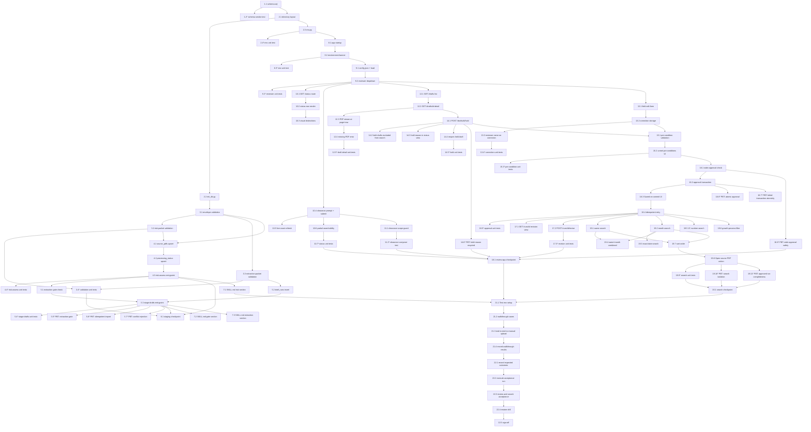

# Implementation Plan: Local Growth Log MVP

## Overview

This plan converts the design and requirements for the Local Growth Log MVP into ordered, independently verifiable coding tasks. Each task builds on the previous ones. The plan covers the SQLite schema, Python staging tool, local review web app, search, and the two-round test sequence (walkthrough + acceptance run).

Tasks are grouped into eight phases. The Task Dependency Graph at the end maps every sub-task into execution waves for parallel scheduling.

---

## Phase 1: Foundation — SQLite Schema and Project Structure

#### Task 1: Create the MVP SQLite schema

**Requires:** none

**Implements:** Requirements 1.4, 21.1–21.6, 24.1

Create `db/schema.sql` defining the five MVP tables (`source_pdfs`, `draft_runs`, `growth_runs`, `run_revisions`, `processing_status`) exactly as specified in the design's [SQLite Schema](#sqlite-schema) section. Include all column types, NOT NULL constraints, and foreign key declarations. Add a `CREATE INDEX` for `source_pdfs(drive_file_id, file_hash)` and for `draft_runs(pdf_id)`. The file must replace (not extend) the pilot schema at `pilot/sqlite/schema.sql`; do not import or reference the pilot tables.

- [ ] 1.1 Write `db/schema.sql` with all five tables and required indexes
  - Define `source_pdfs`, `draft_runs`, `growth_runs`, `run_revisions`, `processing_status`
  - Add `UNIQUE(drive_file_id, file_hash)` constraint on `source_pdfs`
  - Add `FOREIGN KEY` constraints with `ON DELETE RESTRICT`
  - _Requirements: 21.1, 24.1_

- [ ]* 1.2 Write a schema smoke-test script
  - Open an in-memory SQLite database, apply `schema.sql`, and assert all five tables exist with correct column names
  - _Requirements: 21.1_

**Verification:** Running `sqlite3 :memory: < db/schema.sql` exits with code 0 and `.tables` returns all five table names.

---

#### Task 2: Set up project structure and shared utilities

**Requires:** Task 1

**Implements:** Requirements 25.1, 25.4

Create the top-level project layout:

```
db/
  schema.sql          (Task 1)
staging.py            (Tasks 3–6)
review_app/
  app.py
  templates/
  static/
config.json           (reviewer list; environments)
test.sqlite           (created at runtime)
archive.sqlite        (created at runtime)
```

Write a `db/init_db.py` helper that accepts a database path, applies `schema.sql`, and exits. Write a `db/env.py` module that reads the active environment (`test` or `archive`) from a command-line flag or environment variable and returns the correct database path.

- [ ] 2.1 Create the directory layout and placeholder files
  - _Requirements: 25.1_

- [ ] 2.2 Write `db/init_db.py` — apply schema to a given SQLite path
  - _Requirements: 25.1_

- [ ] 2.3 Write `db/env.py` — resolve environment name to database path
  - _Requirements: 25.1, 25.4_

- [ ]* 2.4 Write unit test for `db/env.py`
  - Assert `test` resolves to `test.sqlite` and `archive` resolves to `archive.sqlite`
  - _Requirements: 25.1_

**Verification:** `python db/init_db.py test.sqlite` creates `test.sqlite` and `.tables` lists all five tables; `python db/init_db.py archive.sqlite` creates a separate `archive.sqlite`.

---

## Phase 2: Staging Tool

#### Task 3: Implement packet validation

**Requires:** Task 2

**Implements:** Requirements 21.1–21.6, 24.1–24.3

Write the validation layer in `staging.py`. Validation must be stateless (no database reads yet) and must cover all rules in the design's [Validation rules](#validation-rules) section.

- [ ] 3.1 Implement envelope validation
  - Check `schema_version == 1`, presence and non-emptiness of `stage`, `drive_file_id`, `file_hash`, `model`, `prompt_version`
  - Return a descriptive error string on any failure
  - _Requirements: 21.1, 21.2_

- [ ] 3.2 Implement risk-packet validation
  - Check `decision` is one of `non_critical`, `critical`, `uncertain`; check `issues` is an array
  - _Requirements: 21.4_

- [ ] 3.3 Implement extraction-packet validation
  - Check `runs` is an array; for each run check `draft_id`, `source_locations`, and `fields` with all required keys and valid `status` values
  - _Requirements: 21.5_

- [ ]* 3.4 Write unit tests for all validation rules
  - One test per rule; run against in-memory data only (no SQLite)
  - _Requirements: 21.1–21.6_

**Verification:** Calling validation functions with packets that violate each rule returns a non-empty error string; a valid packet returns `None`.

---

#### Task 4: Implement `risk-assess` command

**Requires:** Task 3

**Implements:** Requirements 1.4, 1.5, 1.6, 4.1, 5.1, 21.1–21.6, 24.1–24.3

Add the `risk-assess` subcommand to `staging.py`. The command must:

1. Load and validate the packet (Task 3).
2. Open the SQLite database (path from CLI argument).
3. Within a single transaction: upsert `source_pdfs` and upsert `processing_status`.
4. Exit 0 and print row count on success; exit 1 with a descriptive error on any failure.

- [ ] 4.1 Implement `source_pdfs` upsert logic
  - On first call for a `(drive_file_id, file_hash)` pair, insert; on retry, reuse existing `pdf_id`
  - On same `drive_file_id` but different `file_hash`, always insert a new row
  - _Requirements: 1.4, 1.5, 1.6_

- [ ] 4.2 Implement `processing_status` upsert logic
  - Set `risk_decision`, `issues_json`, `status` (`risk_assessed` or `held_pending_clearance`), and `updated_at`
  - On retry with unchanged decision, update `updated_at` only
  - _Requirements: 4.1, 5.1_

- [ ] 4.3 Wire validation, upserts, and transaction into the `risk-assess` CLI entrypoint
  - Single transaction; rollback on any error; print rows staged on success
  - _Requirements: 24.1, 24.2, 24.3_

- [ ]* 4.4 Write unit tests for `risk-assess`
  - Test: first call inserts two rows; retry with same hash updates only `updated_at`; retry with new hash inserts new rows; clearance does not carry over to new hash; malformed packet writes nothing
  - _Requirements: 1.4, 1.5, 1.6, 4.1, 5.1_

**Verification:** `python staging.py risk-assess <valid_risk_packet.json> test.sqlite` exits 0, prints "2 rows staged", and `SELECT * FROM processing_status` returns one row with the correct `risk_decision`. Replaying the same packet exits 0 and the row count in `source_pdfs` is still 1.

---

#### Task 5: Implement `stage-drafts` command

**Requires:** Task 4

**Implements:** Requirements 2.3, 2.4, 3.1–3.4, 22.1, 22.2, 23.1, 23.2, 24.1–24.3

Add the `stage-drafts` subcommand to `staging.py`. The command must:

1. Validate the extraction packet (Task 3).
2. Look up `pdf_id` from `(drive_file_id, file_hash)` in `source_pdfs`; reject if not found (Req 21.3).
3. Enforce the Extraction Gate: reject if `processing_status` has neither `non_critical` nor a clearance (Req 2.3, 2.4).
4. For each run: insert `Pending review` row if new; skip if identical (idempotent); conflict-error if `draft_id` exists with different content.
5. Run steps 2–4 in a single transaction; rollback on any failure.

- [ ] 5.1 Implement extraction gate check
  - Query `processing_status` by `pdf_id`; reject if `risk_decision != 'non_critical'` and `clearance_by IS NULL`
  - Return exit code 1 with message identifying `drive_file_id` and `file_hash`
  - _Requirements: 2.3, 2.4_

- [ ] 5.2 Implement `draft_runs` insert with idempotency and conflict detection
  - Skip identical `draft_id`; conflict-error on changed content; insert new rows as `Pending review`
  - _Requirements: 22.1, 22.2, 23.1, 23.2_

- [ ] 5.3 Wire gate check, inserts, and transaction into the `stage-drafts` CLI entrypoint
  - Single transaction; rollback on any error; print rows staged on success
  - _Requirements: 3.1, 3.2, 3.3, 24.1, 24.2, 24.3_

- [ ]* 5.4 Write unit tests for `stage-drafts`
  - Test: extraction without clearance is rejected; extraction after `non_critical` decision inserts rows; identical replay stages zero rows; changed packet reports conflict; unknown PDF version is rejected; failed mid-batch leaves DB unchanged
  - _Requirements: 2.3, 2.4, 22.1, 22.2, 23.1, 23.2_

- [ ]* 5.5 Write property test — Extraction gate (Design Property 1)
  - **Property 1: Extraction gate** — for any packet where `processing_status` has neither a `non_critical` decision nor `clearance_by` populated, `stage-drafts` must exit non-zero and write zero rows
  - **Validates: Requirements 2.3, 2.4**
  - _Requirements: 2.3, 2.4_

- [ ]* 5.6 Write property test — Idempotent import (Design Property 3)
  - **Property 3: Idempotent import** — staging the same extraction packet twice produces zero additional rows on the second call and exits 0
  - **Validates: Requirements 22.1, 22.2**
  - _Requirements: 22.1, 22.2_

- [ ]* 5.7 Write property test — Conflict rejection (Design Property 4)
  - **Property 4: Conflict rejection** — a packet carrying an existing `draft_id` with different JSON content exits non-zero and leaves `draft_runs` unchanged
  - **Validates: Requirements 23.1, 23.2**
  - _Requirements: 23.1, 23.2_

**Verification:** Staging a valid extraction packet after a `non_critical` risk decision exits 0 and `SELECT review_status FROM draft_runs` returns `Pending review` for each run. Replaying the same packet exits 0 and row count in `draft_runs` is unchanged. Staging without a prior non-critical decision exits 1 with a message naming the `drive_file_id`.

---

#### Task 6: Staging tool checkpoint

**Requires:** Tasks 3, 4, 5

**Implements:** Requirements 21.1–21.6, 22.1, 22.2, 23.1, 23.2, 24.1–24.3

Ensure all staging tool tests pass. Confirm the following scenarios work end-to-end against `test.sqlite`:

- [ ] 6.1 Checkpoint — run all staging tool tests and confirm all pass
  - Ensure all tests pass, ask the user if questions arise.
  - _Requirements: 21.1–21.6, 22.1, 22.2, 23.1, 23.2, 24.1–24.3_

**Verification:** `python -m pytest tests/test_staging.py` exits 0 with zero failures.

---

## Phase 3: Codex Skill (`stage-log-runs`)

#### Task 7: Write the `stage-log-runs` skill instructions

**Requires:** Tasks 4, 5

**Implements:** Requirements 1.1–1.6, 2.1–2.4, 3.1–3.4, 4.1–4.3, 5.1–5.5

Write the skill's instruction file at `.agents/skills/stage-log-runs/SKILL.md`. The instructions must specify:

1. How the skill produces the versioned risk JSON packet (envelope fields, decision, issues array).
2. The exact command to call after the risk packet: `python staging.py risk-assess <packet.json> <database.sqlite>`.
3. How the skill reads the staging tool's exit code and output, reports success, or saves the packet and stops on failure without claiming the assessment was recorded.
4. The extraction gate check the skill performs before starting extraction (reads `processing_status` for the exact `pdf_id` and `file_hash`).
5. How the skill produces the versioned extraction JSON packet (runs array, field keys, status values, source locations).
6. The exact command to call after the extraction packet: `python staging.py stage-drafts <packet.json> <database.sqlite>`.
7. The fallback behavior: save the completed packet, report the blocker, stop — never claim drafts were staged without a confirmed staging tool result.
8. The rule that issues confined to the lower measurement table do not raise the risk tier.

- [ ] 7.1 Draft risk-assessment section of `SKILL.md`
  - Packet format, automatic `risk-assess` call, exit-code handling, fallback
  - _Requirements: 1.1, 1.2, 1.3, 1.4, 4.1, 4.2, 4.3_

- [ ] 7.2 Draft extraction gate section of `SKILL.md`
  - Skill reads `processing_status`; proceeds only on `non_critical` or populated `clearance_by`; waits otherwise
  - _Requirements: 2.1, 2.2, 5.3_

- [ ] 7.3 Draft extraction section of `SKILL.md`
  - Packet format, field keys, automatic `stage-drafts` call, exit-code handling, fallback
  - _Requirements: 3.1, 3.2, 3.3, 3.4, 5.1, 5.2, 5.4, 5.5_

**Verification:** An operator reading `SKILL.md` can follow the instructions to produce a valid risk packet and call `risk-assess` without referring to any other document. A code reviewer can confirm that every acceptance criterion in Requirements 1–5 is addressed by a named step in `SKILL.md`.

---

## Phase 4: Review App — Core Infrastructure

#### Task 8: Implement the local web server and environment banner

**Requires:** Task 2

**Implements:** Requirements 25.1, 25.4

Write `review_app/app.py` using a minimal Python web framework (Flask or equivalent). On startup, the app reads the active environment from a flag or environment variable, opens the correct SQLite database, and displays the environment name (`Test` or `Archive`) in a persistent banner on every page.

- [ ] 8.1 Implement app startup — read environment, open database, start server
  - _Requirements: 25.1_

- [ ] 8.2 Implement environment banner in base template
  - Display `Test` or `Archive` label on every page; use visually distinct styling for each
  - _Requirements: 25.4_

- [ ]* 8.3 Write unit test for environment selection
  - Assert the app opens `test.sqlite` when env is `test` and `archive.sqlite` when env is `archive`
  - _Requirements: 25.1_

**Verification:** Starting the app with `--env test` shows "Test" in the banner on every page. Restarting with `--env archive` shows "Archive".

---

#### Task 9: Implement reviewer dropdown from config

**Requires:** Task 8

**Implements:** Requirements 7.1–7.4

Write `config.json` with a `reviewers` array of name strings. Add a shared component that renders the reviewer dropdown and injects the selected name into every form that records a reviewer action. The dropdown must be non-editable during a session; names come only from `config.json`.

- [ ] 9.1 Define `config.json` schema and load it in the app
  - _Requirements: 7.4_

- [ ] 9.2 Implement reviewer dropdown component (template partial)
  - Render names from config; require selection before any recorded action; display selected name on confirmation
  - _Requirements: 7.1, 7.2, 7.3_

- [ ]* 9.3 Write unit tests for reviewer requirement enforcement
  - Assert that any route requiring a reviewer name returns an error when no name is submitted
  - _Requirements: 7.1, 7.3_

**Verification:** Submitting any recorded action (hold, clearance, correction, approval) without selecting a reviewer name returns an error and writes nothing to the database.

---

## Phase 5: Review App — Processing Status View

#### Task 10: Implement processing status view

**Requires:** Tasks 8, 9

**Implements:** Requirements 14.1–14.7

Write the `GET /status` route and template. Query all `source_pdfs` rows joined to `processing_status` and, for PDFs that have reached extraction, aggregate draft run counts by `review_status`.

- [ ] 10.1 Implement `GET /status` route
  - Query `source_pdfs` ⟵ `processing_status`; aggregate `draft_runs` counts per PDF
  - _Requirements: 14.1, 14.2, 14.7_

- [ ] 10.2 Render per-PDF status row: risk tier, status, hold/failure reason, run-count summary
  - Format count line as "N approved · N pending · N held" for extracted PDFs
  - _Requirements: 14.1, 14.2_

- [ ] 10.3 Distinguish `held_pending_clearance` and `technical_failure` outcomes visually
  - Technical failures include a "retryable" indicator
  - _Requirements: 14.5_

- [ ] 10.4 Show clearance prompt for `held_pending_clearance` PDFs
  - Display issues list and a form to submit clearance (uses reviewer dropdown from Task 9)
  - Clearance submission writes `clearance_by`, `clearance_at`, `clearance_note`; transitions status to `cleared`
  - _Requirements: 6.1, 6.2, 6.3, 14.4_

- [ ] 10.5 Update run-count summary on reviewer action (live refresh or redirect after action)
  - _Requirements: 14.3_

- [ ] 10.6 Confirm approved runs from a PDF are searchable while other drafts remain pending
  - Query `growth_runs` independently of `draft_runs` status; no code gates search on all-drafts-approved
  - _Requirements: 14.6_

- [ ]* 10.7 Write unit tests for status view
  - Counts update after a hold and after an approval; clearance transition recorded correctly
  - _Requirements: 14.1–14.7_

**Verification:** After staging two runs from one PDF, the status view shows "0 approved · 2 pending · 0 held". After holding one and approving one, it shows "1 approved · 0 pending · 1 held" and the approved run is searchable.

---

#### Task 11: Implement clearance gate enforcement in the app

**Requires:** Task 10

**Implements:** Requirements 6.4, 6.5

After clearance is recorded in the status view (Task 10.4), confirm the app does not carry clearance across PDF versions. Write the route guard that checks `processing_status.clearance_by` before allowing the operator to resume extraction.

- [ ] 11.1 Confirm clearance is scoped to `(pdf_id, file_hash)` — no carryover to a new version
  - Add a database constraint or query check that rejects clearance lookup for a different `file_hash`
  - _Requirements: 6.5_

- [ ]* 11.2 Write unit test — clearance does not carry across versions
  - Insert a cleared row for version A; query clearance for version B (same `drive_file_id`, different `file_hash`); assert not cleared
  - _Requirements: 6.5_

**Verification:** Inserting a clearance for `file_hash = "abc"` and then querying clearance for `file_hash = "def"` returns no clearance, even when `drive_file_id` is identical.

---

## Phase 6: Review App — Draft Review and Approval

#### Task 12: Implement draft list and source PDF viewer

**Requires:** Tasks 8, 9

**Implements:** Requirements 8.1–8.4, 10.1–10.5

Write `GET /drafts` and `GET /drafts/<draft_id>` routes. The detail view must display extracted fields alongside a rendered or linked view of the source PDF, opened at the page and row recorded in `source_locations_json`.

- [ ] 12.1 Implement `GET /drafts` — list Pending and Held drafts
  - _Requirements: 10.1_

- [ ] 12.2 Implement `GET /drafts/<draft_id>` — draft detail page
  - Show all fields from `original_json` with their `status` and `evidence` values
  - _Requirements: 8.1_

- [ ] 12.3 Implement source PDF viewer — open at the recorded page and row
  - Read `source_pdfs.storage_path`; open the file; navigate to `pdf_index` and `row` from `source_locations_json`
  - _Requirements: 8.2, 8.4_

- [ ] 12.4 Handle missing PDF file gracefully
  - Show error in viewer panel; allow reviewer to continue with available fields
  - _Requirements: 8.3_

- [ ]* 12.5 Write unit tests for draft detail view
  - Missing `storage_path` shows error but page loads; multiple source locations are all accessible
  - _Requirements: 8.3, 8.4_

**Verification:** Opening a draft detail page shows the extracted fields and the source PDF renders at the correct page. Removing `storage_path` from the database shows an error in the viewer panel but does not crash the page.

---

#### Task 13: Implement field correction

**Requires:** Task 12

**Implements:** Requirements 9.1–9.4

Add field-editing controls to the draft detail page. Each edit must capture old value, new value, reason, and source location reference. Corrections are stored separately from `original_json` and are associated with the reviewer's selected name.

- [ ] 13.1 Implement edit form for a single field
  - Require reason before saving; record old value, new value, reason, source location
  - _Requirements: 9.1, 9.2_

- [ ] 13.2 Store corrections separately — do not overwrite `original_json`
  - Save correction records in a session or staging structure; include in approval payload
  - _Requirements: 9.3_

- [ ] 13.3 Require reviewer name before recording a correction
  - Reuse reviewer dropdown component from Task 9
  - _Requirements: 9.4_

- [ ]* 13.4 Write unit tests for field correction
  - Assert `original_json` is unchanged after a correction; correction record contains all four fields
  - _Requirements: 9.3_

**Verification:** Editing a field saves a correction record with old value, new value, reason, and source location. `SELECT original_json FROM draft_runs WHERE draft_id = ?` returns the unmodified original extraction.

---

#### Task 14: Implement hold workflow

**Requires:** Task 12

**Implements:** Requirements 10.1–10.5

Add `POST /drafts/<draft_id>/hold` route. Hold requires a non-empty reason. The route sets `review_status = 'Held'` and records `hold_reason` in `draft_runs`. Held drafts must not appear in search.

- [ ] 14.1 Implement `POST /drafts/<draft_id>/hold`
  - Validate non-empty `hold_reason`; set `review_status = 'Held'`; record `updated_at`
  - _Requirements: 10.1, 10.2_

- [ ] 14.2 Confirm held drafts are excluded from `growth_runs` and search
  - Add query guard in search routes (Phase 7) — implemented here as a database-level check
  - _Requirements: 10.3_

- [ ] 14.3 Show hold reason on the processing status view
  - Held drafts visible to operator with reason text
  - _Requirements: 10.4_

- [ ] 14.4 Implement reopen — allow reviewer to return a Held draft to Pending review
  - _Requirements: 10.5_

- [ ]* 14.5 Write unit tests for hold workflow
  - Hold without reason is rejected; hold with reason sets status; reopen returns to Pending review
  - _Requirements: 10.1–10.5_

- [ ]* 14.6 Write property test — Hold reason required (Design Property 5)
  - **Property 5: Hold reason required** — for any `draft_runs` row with `review_status = 'Held'`, `hold_reason` is non-null and non-empty
  - **Validates: Requirements 10.1, 10.2**
  - _Requirements: 10.1, 10.2_

**Verification:** `POST /drafts/<id>/hold` with an empty reason returns a 400 and `SELECT review_status FROM draft_runs WHERE draft_id = ?` is unchanged. With a non-empty reason, `review_status` becomes `Held` and `hold_reason` is set.

---

#### Task 15: Implement approval pre-condition checks

**Requires:** Tasks 13, 14

**Implements:** Requirements 11.1–11.4

Before allowing the reviewer to submit approval, verify: (1) at least one `source_locations_json` entry with valid page and row, (2) at least one of `researcher_name`, `growth_date`, `jc_number` is populated, (3) `composition_json` is non-null. If any check fails, show which precondition is unmet and offer hold or return-to-editing.

- [ ] 15.1 Implement pre-condition validation function
  - Check source location, lookup value, stoichiometry; return list of unmet conditions
  - _Requirements: 11.1, 11.2, 11.3_

- [ ] 15.2 Display unmet pre-conditions on the approval confirmation page
  - Offer "Hold" and "Return to editing" when any check fails; block approval submit button
  - _Requirements: 11.4_

- [ ]* 15.3 Write unit tests for pre-condition validation
  - Each of the three conditions fails independently; all three failing returns three messages
  - _Requirements: 11.1–11.4_

**Verification:** Attempting to approve a draft with no `composition_json` shows the stoichiometry pre-condition error and the approve button is disabled.

---

#### Task 16: Implement atomic approval transaction

**Requires:** Task 15

**Implements:** Requirements 12.1–12.4, 13.1–13.2

Write `POST /drafts/<draft_id>/approve`. The route must:

1. Read current `run_revisions.version` and `draft_runs.updated_at` (stale-approval check).
2. If either has changed since the reviewer opened the draft, reload and require confirmation.
3. Execute a single SQLite transaction: insert `growth_runs`, insert `run_revisions` (with snapshot, corrections, `approved_by`, `approved_at`), update `draft_runs.review_status` to `Approved`.
4. Display "Saved" only after the transaction commits.
5. On failure, show the error and leave the form editable.
6. On retry of an already-committed approval, detect the existing `run_id` + `version` and return the saved revision without inserting a duplicate.

- [ ] 16.1 Implement stale-approval check
  - Read `version` and `updated_at` before writing; compare with values captured when reviewer opened the page
  - _Requirements: 13.1, 13.2_

- [ ] 16.2 Implement the approval transaction
  - Insert `growth_runs`; insert `run_revisions` with all required fields; update `draft_runs.review_status`
  - _Requirements: 12.1_

- [ ] 16.3 Show "Saved" only on commit; show error and leave form editable on failure
  - _Requirements: 12.2, 12.3_

- [ ] 16.4 Implement idempotent retry — detect committed revision before inserting duplicate
  - _Requirements: 12.4_

- [ ]* 16.5 Write unit tests for atomic approval
  - Successful approval inserts exactly one `growth_runs` row and one `run_revisions` row; failed transaction leaves both tables unchanged; retry returns saved revision without duplicate
  - _Requirements: 12.1–12.4_

- [ ]* 16.6 Write property test — Atomic approval (Design Property 2)
  - **Property 2: Atomic approval** — a `growth_runs` row is never written without a matching `run_revisions` row that has non-null `approved_by` and `approved_at`
  - **Validates: Requirements 12.1**
  - _Requirements: 12.1_

- [ ]* 16.7 Write property test — Failed transaction atomicity (Design Property 9)
  - **Property 9: Failed transaction atomicity** — simulating a failure mid-approval (e.g. rollback after `growth_runs` insert) leaves both `growth_runs` and `run_revisions` unchanged
  - **Validates: Requirements 12.3**
  - _Requirements: 12.3_

- [ ]* 16.8 Write property test — Stale approval safety (Design Property 8)
  - **Property 8: Stale approval safety** — an approval carrying an older `version` number cannot overwrite a revision with a higher version number
  - **Validates: Requirements 13.1, 13.2**
  - _Requirements: 13.1, 13.2_

**Verification:** Approving a valid draft inserts one row in `growth_runs` and one in `run_revisions`; `SELECT approved_by, approved_at FROM run_revisions` returns the reviewer's name and a timestamp. Simulating a mid-transaction error leaves both tables empty.

---

#### Task 17: Implement run revision view and correction workflow

**Requires:** Task 16

**Implements:** Requirements 9.1–9.4, 12.1

Write `GET /runs/<run_id>` to show an approved run with its full revision history. Write `POST /runs/<run_id>/revise` to initiate a correction that follows the same pre-condition and approval transaction as Task 16.

- [ ] 17.1 Implement `GET /runs/<run_id>` — show run with revision history
  - List all `run_revisions` rows in version order; show `changes_json` diff for each revision
  - _Requirements: 12.1_

- [ ] 17.2 Implement `POST /runs/<run_id>/revise` — correction goes through approval workflow
  - Reuse pre-condition checks (Task 15) and approval transaction (Task 16) for the revised values
  - _Requirements: 9.1–9.4_

- [ ]* 17.3 Write unit tests for revision view and correction
  - Each approval increments `version`; `changes_json` records old and new values
  - _Requirements: 12.1_

**Verification:** Approving a run, then revising it, produces two `run_revisions` rows with versions 1 and 2. `SELECT version, approved_by FROM run_revisions ORDER BY version` returns both rows.

---

#### Task 18: Review app checkpoint

**Requires:** Tasks 10–17

**Implements:** Requirements 6–14

Confirm all review app tests pass. Run the full approval workflow end-to-end against `test.sqlite`.

- [ ] 18.1 Checkpoint — run all review app tests and confirm all pass
  - Ensure all tests pass, ask the user if questions arise.
  - _Requirements: 6.1–6.5, 7.1–7.4, 8.1–8.4, 9.1–9.4, 10.1–10.5, 11.1–11.4, 12.1–12.4, 13.1–13.2, 14.1_

**Verification:** All review app tests pass. Opening the app against `test.sqlite`, staging a packet, holding one draft, and approving another all succeed without errors.

---

## Phase 7: Search

#### Task 19: Implement approved-run search

**Requires:** Task 16

**Implements:** Requirements 15.1–15.3, 16.1–16.3, 17.1–17.5, 18.1–18.2, 19.1–19.3, 20.1–20.3

Write `GET /runs` search route. The route must query only `growth_runs` (never `draft_runs`). Support all search fields and combinations described in Requirements 15–20.

- [ ] 19.1 Implement researcher-name search (substring, case-insensitive)
  - _Requirements: 15.1, 16.1, 16.2, 16.3_

- [ ] 19.2 Implement month search (`YYYY-MM` prefix match)
  - Matches both `YYYY-MM` and `YYYY-MM-DD` within the month
  - _Requirements: 17.1, 17.3_

- [ ] 19.3 Implement exact-date search (`YYYY-MM-DD`)
  - _Requirements: 17.2, 17.3_

- [ ] 19.4 Implement combined name + month search (AND logic)
  - _Requirements: 18.1, 18.2_

- [ ] 19.5 Implement JC number search (exact match and substring of raw written JC)
  - Return all runs sharing the same JC number; show source filename and row to distinguish them
  - _Requirements: 19.1, 19.2_

- [ ] 19.6 Implement growth-process filter (CVT / Flux Growth / unclear / any)
  - _Requirements: 19.3_

- [ ] 19.7 Implement sort order
  - Sort: `growth_date` desc; within same date, month-only before day-precision; then `researcher_name` asc; then `run_id` asc
  - _Requirements: 17.4, 17.5, 20.1_

- [ ] 19.8 Implement "Open source PDF" action on each result
  - Read `source_locations_json` from `growth_runs`; open `source_pdfs.storage_path` at the recorded page and row
  - _Requirements: 20.2, 20.3_

- [ ]* 19.9 Write unit tests for search
  - Name-alone, month-alone, combined, exact date, JC number; pending and held drafts must never appear; growth-process filter; sort order
  - _Requirements: 15.1–15.3, 16–20_

- [ ]* 19.10 Write property test — Search isolation (Design Property 7)
  - **Property 7: Search isolation** — for any database state, the search route never returns a row whose `draft_id` appears in `draft_runs` and whose `run_id` does not exist in `growth_runs`
  - **Validates: Requirements 15.1, 15.2, 15.3**
  - _Requirements: 15.1–15.3_

- [ ]* 19.11 Write property test — Approved run completeness (Design Property 6)
  - **Property 6: Approved run completeness** — every row in `growth_runs` has at least one entry in `source_locations_json`, at least one of `researcher_name`/`growth_date`/`jc_number` populated, and a matching `run_revisions` row
  - **Validates: Requirements 11.1–11.3, 12.1**
  - _Requirements: 11.1–11.3, 12.1_

**Verification:** With two approved runs and one pending draft in `test.sqlite`, `GET /runs?name=Alice` returns only Alice's approved runs. `GET /runs?month=2024-03` returns all runs whose `growth_date` starts with `2024-03`, including day-precision entries. The pending draft never appears.

---

#### Task 20: Search checkpoint

**Requires:** Task 19

**Implements:** Requirements 15–20

Confirm all search tests pass and the search view excludes every draft.

- [ ] 20.1 Checkpoint — run all search tests and confirm all pass
  - Ensure all tests pass, ask the user if questions arise.
  - _Requirements: 15.1–15.3, 16–20_

**Verification:** All search tests pass. A manual check confirms no pending or held draft appears in any search result.

---

## Phase 8: End-to-End Testing

#### Task 21: End-to-end walkthrough in Test

**Requires:** Tasks 7, 18, 20

**Implements:** Requirements 27.1–27.5

Run the full workflow from source PDF to approved search result using `test.sqlite`. This task is not automated — it is a structured manual walkthrough. Its verification requirements must be satisfied before it can be marked complete.

**Open item — Walkthrough PDF selection:** The operator must select PDFs from both Binder 1 and Binder 2 that are outside the reserved acceptance list. Filenames and Drive IDs must be recorded in a local Test checklist before the walkthrough begins. This task cannot be marked complete until that selection is recorded.

- [ ] 21.1 Set up Test environment for walkthrough
  - Run `python db/init_db.py test.sqlite`; confirm `test.sqlite` is clean; start review app with `--env test`
  - _Requirements: 25.1, 25.2_

- [ ] 21.2 Run walkthrough for each missing/unclear information case
  - Cover: missing researcher name; missing growth date with usable timestamp; missing growth date without usable timestamp; missing JC number; no usable lookup value; missing stoichiometry; ambiguous stoichiometry; unclear source row or page; missing furnace cycle; missing furnace layout; missing growth process; missing timestamp; missing optional measurement
  - _Requirements: 27.2_

- [ ] 21.3 Run at least one end-to-end path without manual JSON upload
  - Start `$stage-log-runs` on a source PDF; confirm the skill calls `risk-assess` and `stage-drafts` automatically; confirm the draft appears as "Pending review" without any manual JSON upload step
  - _Requirements: 27.3_

- [ ] 21.4 Record walkthrough results before resetting Test
  - Save the Test checklist, staging tool output, and review app screenshots or export to a file before `python db/init_db.py test.sqlite` resets the database
  - _Requirements: 27.4_

**Verification:** Walkthrough PDF filenames and Drive IDs are recorded in the Test checklist before the walkthrough begins. All thirteen missing/unclear cases are covered by at least one PDF. At least one run reaches "Pending review" without manual JSON upload. Results are saved before the Test environment is reset.

---

#### Task 22: Acceptance run in Test

**Requires:** Task 21

**Implements:** Requirements 28.1–28.8, 25.3, 26.1–26.7

Run the formal acceptance check using the reserved acceptance PDF list. This task is not automated — it follows the procedure in DESIGN-MVP.md §7. Two open items must be resolved before this task can be marked complete.

**Open item — Backup folder:** Lab confirmation of the backup folder path and naming convention in the lab's shared Drive is required before the restore drill (step 4 below) can pass.

**Open item — Recovery targets:** Lab confirmation of the RPO (at most one day of approvals) and RTO (restore within one working day) is required before the restore drill can be marked complete.

- [ ] 22.1 Confirm reserved acceptance PDF list and record expected outcomes
  - For each reserved PDF, record: expected risk tier; expected run count; source page and row per run; expected values for name, date, JC number, stoichiometry; expected approval or hold status — all recorded without relying on the skill's output
  - Confirm PDFs were not used in any walkthrough session (Requirement 28.1)
  - _Requirements: 28.1, 28.2, 28.3_

- [ ] 22.2 Execute acceptance run — stage all reserved PDFs in Test
  - Run `$stage-log-runs` on each reserved PDF; compare staging tool output against checklist
  - Confirm eligible drafts appear as "Pending review" without manual JSON upload
  - Confirm critical/uncertain PDFs show hold reason and zero drafts before clearance
  - Where a hold can be resolved, record clearance and re-run to confirm extraction resumes
  - _Requirements: 28.4, 28.5, 28.6_

- [ ] 22.3 Exercise review and search for all reserved PDFs
  - Confirm searches return no pending or held drafts; approve at least one draft per reserved PDF; verify correction provenance, approver name, approval timestamp, and source link; test name-alone, month-alone, and combined search with known expected matches; confirm runs with unresolved critical issues do not appear in search
  - _Requirements: 28.7_

- [ ] 22.4 Restore drill
  - Using SQLite's backup mechanism, create a snapshot of `test.sqlite` with approved acceptance-run results
  - Restore the snapshot into a separate `test_restore.sqlite`
  - Verify: approved runs are searchable, revision history is present, source PDF links open the correct file and page
  - Record restore duration and compare against lab-confirmed recovery targets
  - **Pending lab confirmation:** backup folder path and naming convention; RPO and RTO targets — this task cannot be marked complete until both are confirmed
  - _Requirements: 26.1–26.7_

- [ ] 22.5 Record acceptance outcomes and obtain Iris's sign-off
  - Save every PDF's actual outcome, each check's pass/fail status, the reviewer name, and any discrepancy with its source location
  - Obtain Iris's sign-off before beginning wider batch processing in Archive
  - _Requirements: 28.7, 28.8_

**Verification:** Every reserved PDF has a recorded outcome in the Test checklist. Every eligible draft appeared as "Pending review" without manual JSON upload. Every required approval and hold was exercised. The restore drill confirms approved runs are searchable and source links open the correct PDF page. Iris's sign-off is recorded before the Archive environment is used for batch processing. The restore drill cannot be marked complete until the lab confirms the backup folder and recovery targets.

---

## Notes

- Tasks marked with `*` are optional and can be skipped for faster MVP; they do not block dependent tasks.
- Each task references specific requirements for traceability.
- Checkpoints (Tasks 6, 18, 20) are integration gates; resolve all failures before proceeding.
- Phase 8 tasks are structured manual procedures, not automated tests. Their verification steps state what must be observed, not what a script checks.
- Property tests (Tasks 5.5–5.7, 14.6, 16.6–16.8, 19.10–19.11) validate the correctness properties from the design document.
- **Open items:** Task 21 requires operator PDF selection before it can be marked complete. Task 22.4 requires lab confirmation of backup folder and recovery targets before the restore drill can pass.

---

## Task Dependency Graph


