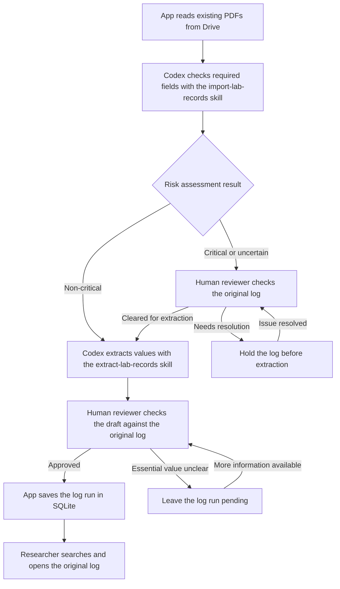

# Quantum Materials Lab — Growth Log Archive Design

**Draft for lab review** · Version 0.5 · November 8, 2026

**Scope** · Automated processing of existing Drive logs, followed by a pilot with in-app photo uploads

## 1. Problem and outcome

A researcher looking for a past log run may have to open several handwritten growth logs and cross-reference a JC number, date, compound, or furnace cycle. A log run is one crystal growth experiment documented in a paper log. One log can contain several log runs. JC numbers were introduced later, so some older log runs lack one. Some numbers are partial or appear on more than one run.

1. **Saved JSON walkthrough.** Run the two Codex steps and load their saved JSON for human review. Approval automatically saves the approved run to SQLite for search.
2. **Shared online MVP.** Authorized reviewers sign in from their own devices to review and approve runs. Researchers can search approved runs by name, date, or JC number and open the original log at the relevant page and row. With approved model API access, the app automates processing of existing Drive PDFs.

The MVP uses the existing Drive PDFs. For the first walkthrough, Codex uses the `import-lab-records` skill to assess risk and the `extract-lab-records` skill to extract values from eligible logs. For each run, the extraction draft includes the researcher’s name, date, JC number if present, and composition as written, including any recorded ratios or weights. It points to the page and row in the original log and marks anything missing or unclear. A human reviewer checks the draft against the original log and approves it before it goes into SQLite.

## 2. Status

- **[Drive inventory](https://drive.google.com/drive/folders/1q7wCJ1IxHwI8ItlhNOxSp9ZoZWkbgrn5).** Folder 1 has 152 prepared PDFs and folder 2 has 203, for 355 files. The archive addresses follow `log-1-###.pdf` and `log-2-###.pdf`. The filename index maps each address to its original file and Drive ID. A file address identifies a scan. A JC number is an optional identifier written on a run.
- **How the paper logs were scanned.** We sorted the logs into two groups. Paper logs that could feed safely through the UW paper scanner were scanned in batches grouped by log binder number. The resulting batches were split into individual PDFs. Paper logs with tape or sticky notes that could catch in the scanner were photographed with Adobe Scan. The 30 repaired Adobe PDFs preserve 35 page images and rendered without the original decoding errors. Each PDF contains one growth log. A growth log can contain several runs, and a run can span pages within that PDF.
- **Extraction and storage.** [Run 01](pilot/runs/chatgpt/pdf-to-json/run01/README.md) is an unvalidated ChatGPT transcription of JC1301–JC1303. A local SQLite walkthrough stages and searches those three rows and demonstrates a reversible correction. These artifacts provide a starting point for the pilot.

## 3. MVP decisions and trade-offs

1. **Read the organized collection directly from Drive.** Connect the app to the two archive folders with read access. Use the filename index and Drive file IDs to track what has already been processed. Keep the original PDFs in Drive and use SQLite on the shared server for review and search.
2. **Use Codex with the `import-lab-records` skill for risk assessment.** For the first walkthrough, the skill checks whether the required fields are present and readable. It returns a risk tier, a reason, and the relevant location in the original log. Critical or uncertain assessments go to human review. The operator can retry a technical failure. Non-critical logs move directly to extraction.
3. **Use Codex with the `extract-lab-records` skill for extraction.** Extract the values into a JSON draft and flag unclear handwriting or missing values. A human reviewer checks every draft against the original log. Their approval is required before import, regardless of the log's risk tier.
4. **Preserve the draft and review decision.** Keep every original extraction draft, including drafts that remain pending, and make them available to the operator and authorized reviewers in the internal review workspace. Keep each approved version with its review decision. An identical retry can reuse the existing decision.

**Keep the two skills focused.** Prototype `import-lab-records` outside the archive app for risk assessment. Use the [Run 01 prompt](pilot/runs/chatgpt/pdf-to-json/run01/pdf-to-json-v1.text) as the starting point for `extract-lab-records`, with the current field rules. Preserve the original PDF and save the draft separately. Convert the legacy Run 01 output to the draft format before using it in the walkthrough. The app records the human review decision and handles SQLite import.

**First run without an API.** The project operator runs both skills in Codex using their own ChatGPT subscription and saves the model name, prompt version, and JSON output for each step. The operator loads the saved drafts and source PDFs into the review app. In both the walkthrough and the automated MVP, the reviewer's approval triggers the app to save that version to SQLite automatically.

**Model access for automation.** The target is for the app to read Drive and start the two AI steps automatically. The walkthrough uses the operator’s ChatGPT subscription. The hosted app’s credentials and funding for unattended model calls are still open. Before running the automated batch, confirm which endpoint may receive the lab PDFs, that it supports PDFs, and who owns the API account and pays for usage. Keep model and Drive credentials on the server. Measure usage on the test set, estimate the cost of the selected batch, and set a spending limit. Keep the same risk and human review rules when moving from saved JSON to API responses.

### JSON handoff

Use the same versioned JSON format for saved Codex results and automated model results. Each packet covers one PDF version. The operator or app adds the source and model metadata.

- Every packet includes `schema_version` (initially `1`), `stage` (`risk` or `extraction`), `pdf_id`, `file_hash`, `model`, and `prompt_version`.
- A risk packet includes `decision` (`critical`, `non_critical`, or `uncertain`) and an `issues` array. Each issue gives a reason and its source location when available. An empty array means the assessment found no issues.
- An extraction packet includes a `runs` array. Each entry has a packet-local `draft_id`, `source_locations`, and a `fields` object. Use the field keys `researcher_name`, `growth_date`, `jc_number`, `composition`, `furnace_cycle`, `furnace_layout`, `growth_process`, `timestamps`, and `measurements`.
- Each field includes `status`, `raw_value`, `value`, and `evidence`. Use `recorded`, `inferred`, `derived`, `missing`, `unreadable`, `ambiguous`, or `omitted`. Use JSON null for unknown values. Dates use `YYYY-MM` or `YYYY-MM-DD`, and JC numbers remain text as written. Evidence records a source location or explains why the value is unavailable. Locations use a page number starting at 1 and a row, section, or marked region when available.

Validate the packet version, required keys, and source PDF before loading it for review. Invalid packets become technical failures. The app matches drafts to stable run IDs and records approvals separately from model output. Only a reviewer action can approve a run.

## 4. Workflow and ownership

This Mermaid flowchart shows the target automated Drive workflow and where a human reviewer makes a decision. The model steps are labeled with the Codex skills used in the first walkthrough. The automated app reuses their instructions once API access is available. The shared server stores the official SQLite database.

1. **App reads the existing PDFs from Drive.** Use the inventory to find the logs and keep their Drive file IDs with the extracted data.
2. **Codex assesses each log's risk with the `import-lab-records` skill.** Check the required fields in the original log for missing, unreadable, or ambiguous values. Save the risk tier and the evidence. Critical or uncertain logs stay on hold until a human reviewer clears them for extraction. Hold the whole PDF if any run has a critical issue. For example, a readable row still waits if another row in the same growth log has an ambiguous compound.
3. **Codex extracts values with the `extract-lab-records` skill.** Use the skill on eligible logs to produce a JSON draft. Save the draft and its model version. Flag unclear or missing values and identify the page and row for each run.
4. **Human reviewer checks each draft.** Give authorized reviewers access to open the original PDF alongside the extracted fields, manually correct individual fields, and approve the reviewed version. For each correction, save the old and new values, the reason, and the source location. Record who made the edit, who approved the version, and when. Approve a run when the reviewer can confirm a searchable value, the stoichiometry, and the source location. Hold the run before import if a required value is missing or a critical issue remains unresolved.
5. **App saves approved log runs to SQLite automatically.** The reviewer's approval triggers the save. Researchers can then search by name, date, or JC number, filter by growth process, and open the original log at the relevant page and row.

In the automated workflow, the app handles Drive intake, model calls, and import. The human reviewer handles risk clearance and checks the extracted values.

**Access.** Anyone can view the lab data, including approved runs and their source PDFs. The operator and authorized reviewers can view extraction drafts in the internal review workspace. Reviewers sign in with individual accounts. Only authorized reviewers can edit and approve runs. One authorized approval is required per run.

## 5. Log Run Review and Extraction

### Risk tiers before extraction

- **Critical · Review before extraction.** Use this tier when a run has no searchable value or when an issue could attach data to the wrong run or change the scientific meaning of a core field. Examples include an uncertain row or an ambiguous compound, ratio, or unit. A human must clear the log before extraction. If a critical issue first appears in the draft, resolve it before importing the affected run. An absent or duplicate JC number is valid when the run still has a searchable value and a clear location in the original log.
- **Non-critical · Send to extraction.** Use this tier for optional details that can remain unknown without changing the core values for that log run, such as a missing layout note or an unclear timestamp when another searchable value is available. Keep the uncertainty visible in the draft.

Use real logs to check the review rules before the pilot. Include a missing JC number with another searchable value, missing stoichiometry, an ambiguous composition or unit, and a missing optional measurement.

### Fields and extraction rules

| Fields | Requirement | What to extract | When to flag for review |
| --- | --- | --- | --- |
| Lookup | At least one of researcher name, date, or JC number is required. | Keep the date at its recorded precision and the JC number as written. Start and end timestamps are optional and serve only as a fallback when the date is missing. | Hold the PDF before extraction if no searchable value can be established or if ambiguity could link data to the wrong run. Hold the affected run before import if either issue remains. |
| Composition | Stoichiometry is required for import. | Keep the formula, written ratios in component order, weights and units, and separate calculated and measured values. | Hold the PDF before extraction if ambiguity could change the stoichiometry, such as an overwritten digit, unclear element symbol, or unknown ratio basis. Hold the run before import if stoichiometry is missing or unresolved, even when the run has a searchable value. |
| Furnace cycle | Optional | Capture the written cycle or graph when present, including the starting temperature, ramps, dwells, and decant temperatures. | Flag unclear temperatures, units, or graph labels in the draft and continue processing. |
| Furnace layout | Optional | Mark whether a sketch is present, absent, or unclear. When present, keep an image of the sketch with its location in the original log. | — |
| Growth process | Optional | Categorize the run as CVT (chemical vapor transport) or Flux Growth. Mark the method unclear when the evidence is inconclusive. Keep the evidence for the classification. | — |

**Dates and JC numbers.** Month and year are the minimum precision for placing a log run in chronological order. Group runs by month and preserve the exact day when it is recorded. For runs on the same date without JC numbers, sort alphabetically by researcher name, then by log run ID if names match. Where both a date and a full JC number are present, check that the JC sequence follows date order at the precision available. Flag discrepancies for review and keep both values as written. Return every match for a duplicate JC number and distinguish the runs by their original log, page, and row.

If a fallback timestamp establishes a date or month, keep it as evidence and use the supported date precision for search and sorting. If the month cannot be established, flag it for review and keep the run searchable by any other available lookup value.

Some logs show only the last two digits of the JC number. Preserve them as written, including leading zeros.

**Compound carry-down.** When a compound is written once for consecutive runs in the same column, carry it down through the following blank compound cells until another compound is written or the table ends. Mark the value as carried down and point to the cell where it was written. Flag unclear boundaries for review.

**Why `x` is optional.** The log's stoichiometry can be used to calculate `x` when the composition or substitution basis is known. If the log gives elemental masses, use periodic-table atomic weights to convert the masses to moles and find the atomic ratios. When the log explicitly gives 5% substitution on the relevant site, the equivalent fraction is `x = 0.05`.

Display the raw composition with search results. Capture measurements when recorded. Leave load out of the MVP. Preserve the difference between an inspected blank, an unreadable entry, an ambiguous reading, an inferred value, and a value omitted by the extractor.

In the JSON draft, list missing or unclear values with the page and row or annotation in the original log so the human reviewer can check them. Check sticky notes and margins for relevant information. If a mark such as `n` is unexplained or composition notation appears in an unexpected column, preserve the written value and its location. Propose an interpretation only when the surrounding context supports it, and flag it for review.

### Furnace cycle

- **Dwell (stay)** means hold at the same temperature for a period of time. A constant temperature over an interval can indicate a dwell even if the log leaves the word out.
- **Ramp** means change from a starting temperature to a target temperature over a stated time or at a stated rate. The lab notes use room temperature as the starting condition for the first ramp. When the log says “room temperature,” keep that wording and leave the numeric value blank unless the log gives one. Leave an unstated starting condition blank.

“Ramp to 850 in 24 hours, dwell for 4 hours” means reach 850 over 24 hours, then stay at 850 for four hours. If the log gives no unit for 850, keep the value, leave its unit blank, and flag it for review. Apply the same rule to other temperatures without a stated unit.

If a log lists multiple decant temperatures, capture each one with its unit in the order written.

**Reading a furnace graph.** For a time–temperature graph, read time on the x-axis and temperature on the y-axis. Record rising segments as heating, flat segments as holds, and falling segments as cooling. If the graph shows separate left and right furnace temperatures, keep both traces and their labels. Flag unclear axes, units, or zone labels.

### CVT or Flux Growth

1. **Check for an explicit method.** Use the growth method named for that run when the rest of the log supports it or gives no conflicting evidence. If the evidence conflicts, preserve the written label and flag the classification for review.
2. **Check the table, margins, and sticky notes.** Look for a named transport agent or a note about vapor transport as CVT evidence. The lab notes give small amounts of iodine, such as 10 or 15 mg, as clues to check in context. A note about decanting residual liquid from the crystals supports flux growth.
3. **Check the furnace cycle, graph, and layout.** Two different temperatures held at the same time on opposite sides support CVT. If two temperatures have no labels, use the rest of the page to distinguish simultaneous zones from successive steps. Heating to melt the charge, holding at high temperature, and slowly cooling toward a lower hold or decant support flux growth. Heating, holding, and cooling alone are shared clues.
4. **Check the ratio and whether the mixture could stay liquid.** Treat ratios such as 100:1 or 200:1 as supporting flux clues. Preserve the component order and ratio basis when stated. If the basis is known, identify the element with the largest atomic share and compare its pure melting point with the decant temperature or last recorded growth temperature. For a borderline case, check the phase diagram for the recorded mixture. A liquid phase at that temperature supports flux growth when the rest of the log fits.
5. **Keep uncertain cases unclear.** If the clues conflict or only weak clues are available, mark the method unclear. In the draft, point the human reviewer to the relevant parts of the original log and explain which clue is missing or conflicts.

Record how the run ended when the log gives that detail, such as shutdown, slow cooldown, crystal removal while the furnace remained on, or decanting.

## 6. Server storage

Keep the PDFs in approved Drive storage. The import packet carries a stable log run ID, one source PDF with the relevant page and row locations, written values, any confirmed normalized values, and the human review decision. SQLite stores the searchable fields, growth process, source reference, and review details. Use the internal log run ID as the key so duplicate, missing, or partial JC numbers can be preserved.

**Shared test host for the MVP.** Run one app instance with the official SQLite database on persistent storage. Reviewers connect over HTTPS from their own devices. Each approval applies to the draft version the reviewer opened. If that version has changed or was already approved, show the latest state before allowing any further approval. Back up the database and review workspace to approved lab storage, and test restoring them with their linked PDFs. The number of PDFs required for MVP acceptance is still to be decided.

Import a batch in one transaction. A malformed packet should leave the database unchanged. An identical reimport should create zero new rows. A changed packet for an existing log run should surface a conflict for the operator. Keep scans, private links, imported research data, and database files out of Git.

**Match runs after re-extraction.** Match each new draft to an existing run using the exact PDF version and its physical location on the page. On an unchanged PDF, reuse the existing `run_id` when the match is unambiguous, even if the extractor changes its row labels. For a replaced PDF or an ambiguous location, have a reviewer compare the old and new sources and confirm whether the draft is an existing run or a new one. Keep the last approved version searchable while the match is pending.

### SQLite data model

These are the proposed MVP columns. The SQLite schema will define the final constraints and indexes.

**`source_pdfs`** has one row per version of a growth log PDF.

- `pdf_id` is the internal primary key.
- `archive_filename` is the name shown in the archive.
- `drive_file_id` identifies the original PDF in Drive.
- `file_hash` identifies the exact PDF contents. If a Drive file is replaced, keep the previous version and its source references so earlier approvals still point to the PDF the reviewer saw.
- `storage_path` locates the retained copy on the server when one is needed to preserve the exact PDF version.

**`growth_runs`** has one row per approved experimental run.

- `run_id` is the internal primary key. `pdf_id` links to `source_pdfs`. Several runs can point to the same PDF.
- `researcher_name`, `growth_date`, and `jc_number` support lookup. At least one is required. Store the JC number exactly as written, using text to preserve partial numbers and leading zeros. JC numbers can repeat across runs.
- `date_precision` records whether the date is known to the day or month. A month-only value such as `2020-01` stays at month precision.
- `growth_process` stores CVT, Flux Growth, or unclear when a classification was attempted. It supports filtering and can be empty.
- `composition_json` stores the confirmed stoichiometry, including the formula, ratios, weights, and units when available.
- `source_locations_json` stores the relevant PDF page and row references. At least one source location is required.
- `details_json` stores optional information such as furnace steps, sketch references, and evidence for the growth process.

**`run_revisions`** has one row per approved version of a run.

- `run_id` links to `growth_runs`. Together, `run_id` and `version` identify a revision.
- `approved_values_json` stores a snapshot of the approved values. `changes_json` records the fields changed, their old and new values, and the reason for each correction.
- `edited_by` and `edited_at` record who made the edit and when. These can be empty if the reviewer approved the draft as written.
- `approved_by` and `approved_at` record who approved the version and when.

An authorized reviewer can revise an existing run through the same review workflow. When the reviewer approves a run or a correction, the app saves the approved revision and the searchable run together in one SQLite transaction. Search uses the latest approved version.

Show **Saved** only after the transaction commits. If the save fails, show the error and let the reviewer retry the same approval. A retry of an already committed approval returns the saved revision without adding another one.

**Run review status.** The internal review workspace labels drafts **Pending review**, **Held**, or **Approved**. When a run is held, record the reason and the source location when available so the reviewer knows what to resolve. Only approved runs enter `growth_runs` and appear in search. The associated `run_revisions` row records `approved_by` and `approved_at` and preserves any correction notes.

**`processing_status`** is a table in the same SQLite database, with one row per PDF version. Store `pdf_id`, `status`, `reason`, and `updated_at`. Distinguish PDFs held pending better evidence from technical failures that can be retried. A held PDF remains visible to the operator and can return to review when better evidence arrives. Keep pending drafts in the review workspace. Keep a PDF in review while any run still needs a decision. Approved runs from that PDF can be searchable while other runs remain pending after extraction. Report those partial outcomes alongside fully processed, held, and failed PDFs.

## 7. MVP acceptance checks

**MVP collection.** Before the acceptance test, agree with the lab on a fixed list of PDFs from the Drive inventory. Record a processing outcome for every PDF on the list. A PDF can remain held with a documented reason. Check that technical failures are visible and can be retried.

Use Run 01 as an extraction baseline. Before processing the wider batch, have a human reviewer check a small set of original PDFs and record the expected risk decisions, runs, field values, and source locations. Include both risk tiers, a PDF with multiple runs, a run spanning pages within one PDF, a missing JC number with another searchable value, missing stoichiometry, and an unresolved optional detail. Reserve some PDFs for the final check after the instructions are fixed.

**Go/no-go for the wider batch.** Proceed once the human reviewer confirms that the final check caught every critical issue that should hold a PDF before extraction, included every expected run in the PDFs cleared for extraction, and linked each draft to the correct PDF and page or row. Also verify that every test run with missing stoichiometry or an unresolved critical issue stays out of SQLite and that every import has human approval. If any check fails, fix the issue and rerun the check before expanding. Track unnecessary review holds, other extraction errors, and reviewer correction time to guide improvements.

**Researcher feedback.** Before expanding the batch, ask researchers to find an approved run and open its original log. Ask authorized reviewers to compare a draft with the PDF, correct a field, and approve it. Record where people get stuck and fix problems that prevent them from completing either task.

For the first walkthrough, use saved JSON to verify that human approval automatically saves the approved version to SQLite. With approved model API access, the automated MVP is ready when the team can:

- Read existing PDFs from Drive and assess risk without someone uploading each log.
- Send a non-critical log directly to extraction. Verify that a critical or uncertain log is held until a human clears it.
- Confirm that pending and held drafts are visible in the review workspace, held drafts show their reason, and only approved runs enter `growth_runs` and become searchable. Verify that the saved revision identifies the approver and approval time.
- Verify that the operator can inspect pending and approved drafts internally. Have an authorized reviewer correct a field against the original PDF, approve the revision, and verify that the approved value is searchable under the same run ID with the prior value and approval history preserved.
- Find a known run by name, date or month, or JC number and open the original log at the relevant page and row. Verify that a timestamp can establish a searchable month when the date is missing. Confirm a month-only date is shown without an invented day.
- Keep missing and partial JC numbers as recorded, return all runs that share a JC number, and sort same-date runs without JC numbers alphabetically by researcher name.
- Verify a carried-down compound against its original cell and filter reviewed runs by CVT or Flux Growth.
- Check that a furnace layout image opens from its log run and that the draft points the reviewer to unclear notation in the original log.
- Hold a searchable run before import if stoichiometry is missing or a critical issue remains unresolved. Import an approved run with an optional detail marked unresolved, such as a missing furnace temperature unit.
- Retry the same import without duplicating database entries and see a clear error for an invalid or conflicting packet.
- Re-extract an unchanged PDF with different row labels and verify that the same runs keep their IDs. Replace a PDF and verify that a reviewer must confirm the matches before any approved records change.
- Simulate a failed approval save and verify that neither the searchable run nor its revision changes. Retry the same approval and verify that it saves exactly one revision, including when a previous save committed before the app could show confirmation.
- Verify that a held PDF and a failed PDF appear as distinct outcomes and that every PDF in the MVP collection has a recorded outcome.
- Load a saved Codex packet and an automated model packet through the same validator. Verify that an invalid packet stays out of review.
- Have authorized reviewers sign in from two devices and approve separate drafts. Have both open the same draft and verify that a stale approval cannot overwrite a newer decision or create a duplicate revision. Verify that an account without reviewer access cannot edit or approve.
- Restore a backup and verify that the approved runs, their review history, and linked PDFs are available.

[After the MVP](pilot/DESIGN.md)
