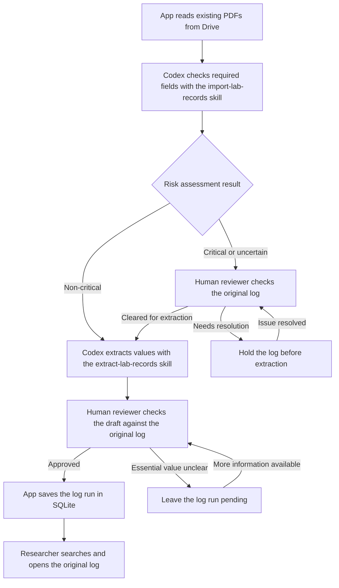

# Quantum Materials Lab — Growth Log Archive Design

**Draft for lab review** · Version 0.5 · November 8, 2026

**Scope** · Automated processing of existing Drive logs, followed by a pilot with in-app photo uploads

## 1. Problem and outcome

A researcher looking for a past log run may have to open several handwritten growth logs and cross-reference a JC number, date, compound, or furnace cycle. A log run is one crystal growth experiment documented in a paper log. One log can contain several log runs. JC numbers were introduced later, so some older log runs lack one. Some numbers are partial or appear on more than one run.

The MVP succeeds when a researcher can look up an imported log run by name, date, JC number, or a recorded timestamp and open the original log at the relevant page and row while offline. The shared app should make the full archive the researcher is authorized to access available offline after a complete sync.

**The later pilot adds photo uploads.** Researchers take a photo of a paper log and submit it in the app. The app handles PDF conversion, file checks, and submission tracking through extraction and review.

The MVP uses the existing Drive PDFs. For the first walkthrough, Codex uses the `import-lab-records` skill to assess risk and the `extract-lab-records` skill to extract values from eligible logs. For each run, the extraction draft includes the researcher’s name, date, JC number if present, and composition as written, including any recorded ratios or weights. It points to the page and row in the original log and marks anything missing or unclear. A human reviewer checks the draft against the original log and approves it before it goes into SQLite.

## 2. Status

- **[Drive inventory](https://drive.google.com/drive/folders/1q7wCJ1IxHwI8ItlhNOxSp9ZoZWkbgrn5).** Folder 1 has 152 prepared PDFs and folder 2 has 203, for 355 files. The archive addresses follow `log-1-###.pdf` and `log-2-###.pdf`. The filename index maps each address to its original file and Drive ID. A file address identifies a scan. A JC number is an optional identifier written on a run.
- **How the paper logs were scanned.** We sorted the logs into two groups. Paper logs that could feed safely through the UW paper scanner were scanned in batches grouped by log binder number. The resulting PDFs were then split into one PDF per page. Paper logs with tape or sticky notes that could catch in the scanner were photographed with Adobe Scan. The 30 repaired Adobe PDFs preserve 35 page images and rendered without the original decoding errors. Some logs contain several runs, and a run may span several pages in the original log.
- **Extraction and storage.** [Run 01](../pilot/runs/chatgpt/pdf-to-json/run01/README.md) is an unvalidated ChatGPT transcription of JC1301–JC1303. A local SQLite walkthrough stages and searches those three rows and demonstrates a reversible correction. These artifacts provide a starting point for the pilot.

## 3. MVP decisions and trade-offs

1. **Read the organized collection directly from Drive.** Connect the app to the two archive folders with read access. Use the filename index and Drive file IDs to track what has already been processed. Keep the original PDFs in Drive and use SQLite for review and offline search.
2. **Use Codex with the `import-lab-records` skill for risk assessment.** For the first walkthrough, the skill checks whether the required fields are present and readable. It returns a risk tier, a reason, and the relevant location in the original log. Critical, uncertain, or failed assessments go to human review. Non-critical logs move directly to extraction.
3. **Use Codex with the `extract-lab-records` skill for extraction.** Extract the values into a JSON draft and flag unclear handwriting or missing values. A human reviewer checks every draft against the original log. Their approval is required before import, regardless of the log's risk tier.
4. **Preserve the draft and review decision.** Keep the original draft and the approved version. If a person changes a value, save the revision and review decision. An identical retry can reuse the existing decision.

**Keep the two skills focused.** Prototype `import-lab-records` outside the archive app for risk assessment. Use the [Run 01 prompt](../pilot/runs/chatgpt/pdf-to-json/run01/pdf-to-json-v1.text) as the starting point for `extract-lab-records`, with the current field rules. Preserve the original PDF and save the draft separately. Treat the Run 01 output as an example while the JSON format is being confirmed. The app records the human review decision and handles SQLite import.

**First run without an API.** Run both skills in Codex. Save the model name, prompt version, and JSON output for each step. The local app accepts those outputs in the same format it will accept from an API later. Once the PDFs and drafts are downloaded, human review, import, and search can run locally.

**Model access for automation.** The target is for the app to read Drive and start the two AI steps automatically. The project has no confirmed model API credentials or budget. Confirm an approved endpoint, PDF support, and who pays for usage before adding unattended model calls. Keep the same risk and human review rules when moving from saved JSON to API responses.

## 4. Workflow and ownership

This Mermaid flowchart shows the target automated Drive workflow and where a human reviewer makes a decision. The model steps are labeled with the Codex skills used in the first walkthrough. The automated app reuses their instructions once API access is available. SQLite and downloaded copies of the original logs stay available offline.

1. **App reads the existing PDFs from Drive.** Use the inventory to find the logs and keep their Drive file IDs with the extracted data.
2. **Codex assesses each log's risk with the `import-lab-records` skill.** Check the required fields in the original log for missing, unreadable, or ambiguous values. Save the risk tier and the evidence. Critical or uncertain logs stay on hold until a human reviewer clears them for extraction. If any run in a PDF has a critical issue, hold the PDF for review.
3. **Codex extracts values with the `extract-lab-records` skill.** Use the skill on eligible logs to produce a JSON draft. Save the draft and its model version. Flag unclear or missing values and identify the page and row for each run.
4. **Human reviewer checks each draft.** Compare the extracted runs and values with the original log. Approve a run if the essential values can be confirmed. Leave it pending if an essential value is unclear. The app saves the reviewer, date, and reviewed version.
5. **App saves approved log runs to SQLite.** Researchers can search by name, date, JC number, or a recorded timestamp, filter by growth process, and open the original log at the relevant page and row.

In the automated workflow, the app handles Drive intake, model calls, and import. The human reviewer handles risk clearance and checks the extracted values.

## 5. Log run fields and scientific boundaries

**Required for lookup.** Each log run needs at least one searchable value: researcher name, recorded date, JC number, or a start or end timestamp. Capture stoichiometry separately, including written ratios.

| Field group | Capture | Critical |
| --- | --- | --- |
| Lookup | Researcher name, date at its written precision, and JC as written. Check the start and end timestamps if both date and JC are missing. | No searchable value can be established, or an ambiguous value could link the data to the wrong run |
| Composition | Formula, ratios with component order, weights and units, and separate calculated and measured values. | An overwritten digit, unclear element symbol, or unknown ratio basis changes how the stoichiometry could be read |
| Furnace program | Optional source note for the written program or a pointer to the graph | — |
| Growth process and layout | Categorize the run as chemical vapor transport (CVT), flux growth, or unclear. Keep any transport-agent or layout notes. | — |

**Dates and JC numbers.** Sort by recorded date when available, including older runs without JC numbers. For runs on the same date without JC numbers, sort alphabetically by researcher name, then by log run ID if names match. Where both a date and a full JC number are present, check that the JC sequence follows date order. Flag discrepancies for review and keep both values as written. Return every match for a duplicate JC number and distinguish the runs by their original log, page, and row. Start and end timestamps are optional and can be used for lookup when the date and JC number are missing. If a timestamp supports a date, retain it as evidence.

**Compound carry-down.** When a compound is written once for consecutive runs in the same column, carry it down through the following blank compound cells until another compound is written or the table ends. Mark the value as carried down and point to the cell where it was written. Flag unclear boundaries for review.

Display the raw composition with search results. Capture measurements when recorded and leave load outside the required pilot fields. Preserve the difference between an inspected blank, an unreadable entry, an ambiguous reading, an inferred value, and a value omitted by the extractor.

For growth process, a transport agent and labeled simultaneous furnace zones can support CVT. A high charge ratio, cooling program, and terminal decant can support flux growth. Keep the evidence, and leave the category unclear if the original log and human review cannot establish the process.

### Risk tiers for human review

- **Critical · Review before extraction.** Use this tier when a run has no searchable value or when an issue could attach data to the wrong run or change the scientific meaning of a core field. Examples include an uncertain row or an ambiguous compound, ratio, or unit. A human must clear the log before extraction. If a critical issue first appears in the draft, resolve it before importing the affected run. An absent or duplicate JC number is valid when the run still has a searchable value and a clear location in the original log.
- **Non-critical · Send to extraction.** Use this tier for optional details that can remain unknown without changing the core values for that log run, such as a missing layout note or an unclear optional timestamp. Keep the uncertainty visible in the draft. If a timestamp is the only evidence for a date the log run depends on, review it as a critical issue.

These tiers are proposed for the lab to confirm using real logs before the pilot. Review a missing JC number, an ambiguous composition or unit, and a missing optional measurement together. Record which cases block AI evaluation or import, and use those decisions in the pilot review rules.

## 6. Local storage

Keep the PDFs in approved Drive storage. The import packet carries a stable log run ID, source file/page/row, written values, any confirmed normalized values, and the human review decision. SQLite stores the searchable fields, growth process, source reference, and review details. Use the internal log run ID as the key so duplicate, missing, or partial JC numbers can be preserved.

**Offline use in the MVP.** Before disconnecting, put the SQLite database, the local search tools, and every original log PDF in the pilot collection on the laptop. Store a local file reference alongside the Drive reference so search results can open the source without a connection. The operator can also import a reviewed packet already on the laptop. Drive retrieval and cloud extraction wait until the connection returns.

Import a batch in one transaction. A malformed packet should leave the database unchanged. An identical reimport should create zero new rows. A changed packet for an existing log run should surface a conflict for the operator. Keep scans, private links, imported research data, and database files out of Git.

## 7. MVP acceptance checks

Check the risk model's decisions against a human reviewer's decisions on the same logs. Track critical logs the model incorrectly marks non-critical and non-critical logs it unnecessarily sends to review. Use Run 01 as an extraction baseline and have a human reviewer establish the expected rows and values for the logs used in testing.

Once the lab has confirmed the review rules and checked the expected values against the original logs, compare the extraction drafts with those values. Report critical and non-critical errors separately, including missed rows, and track the time spent reviewing and correcting drafts. Reserve a few pages to check the result after the instructions are fixed. If extraction fails or the original log cannot support a critical value, keep that log run out of the import until the issue is resolved.

For the first walkthrough, use saved JSON to test human review and SQLite import. With approved model API access, the automated MVP is ready when the team can:

- Read existing PDFs from Drive and assess risk without someone uploading each log.
- Send a non-critical log directly to extraction. Verify that a critical or uncertain log is held until a human clears it.
- Confirm that every extraction draft waits for human approval before it enters SQLite, including drafts from non-critical logs.
- Find a known run by name, date, JC number, or a fallback timestamp and open the original log at the relevant page and row.
- Keep missing and partial JC numbers as recorded, return all runs that share a JC number, and sort same-date runs without JC numbers alphabetically by researcher name.
- Verify a carried-down compound against its original cell and filter reviewed runs by CVT or flux growth.
- Hold a row with an unresolved critical issue and import a reviewed row with an optional detail marked unresolved.
- Retry the same import without duplicating database entries and see a clear error for an invalid or conflicting packet.
- Disconnect the laptop and reopen the local tools. Search the pilot log runs and verify that every original log PDF in the pilot collection opens without a connection.

## 8. After the MVP

**Researcher photo-upload pilot.** Researchers take a photo of a paper log and upload it in the app. The app checks that the whole log is readable, converts it to PDF, and verifies that every page renders. It asks for a retake if the photo is blurry or cropped. After upload, the app shows submission status and carries the PDF through the same extraction, review, and import workflow tested in the MVP.

**Reuse the processing workflow.** Once an uploaded photo becomes a PDF, send it through the same risk assessment, extraction, human review, and import steps used for the existing Drive logs.

**Offline archive access.** Sync the full authorized archive to the device, including the searchable log runs and their original logs. Show when the download is complete and when it last synced. Keep the last complete copy usable if a refresh is interrupted. A researcher can still browse and open the downloaded archive while new uploads and updates wait for a connection.

**Offline photo capture.** Save the photo on the device when the connection drops and show it as pending. Upload and start extraction after reconnecting. Keep the pending photo until the archive confirms the PDF was saved and passed its rendering check. Use the same submission ID for retries to avoid duplicates. Test by taking a photo offline, reopening the capture screen, and reconnecting.

Before rolling this out, confirm who handles exceptions. Test on actual phone photos, including pages with several runs and notes in the margins. Measure both the time researchers spend submitting a log and the time reviewers spend checking it.

Meanwhile, instrument data lives on lab computers and Dropbox, and some files are also shared in Slack. Those overlapping digital sources can be reconciled later.
