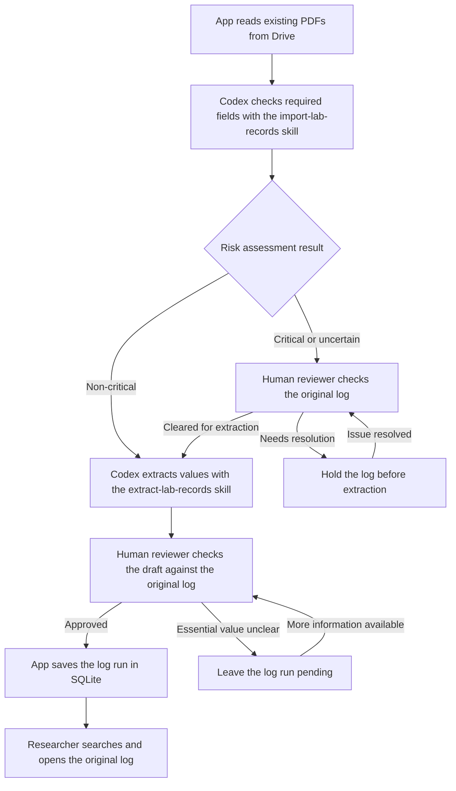

# Quantum Materials Lab — Growth Log Archive Design

**Draft for lab review** · Version 0.5 · November 8, 2026

**Scope** · Automated processing of existing Drive logs, followed by a pilot with in-app photo uploads

## 1. Problem and outcome

A researcher looking for a past log run may have to open several handwritten growth logs and cross-reference a JC number, date, compound, or furnace cycle. A log run is one crystal growth experiment documented in a paper log. One log can contain several log runs. JC numbers were introduced later, so some older log runs lack one. Some numbers are partial or appear on more than one run.

1. **Saved JSON walkthrough.** Run the two Codex steps and use their saved JSON to demonstrate human review, SQLite import, and local search.
2. **Automated MVP with local offline search.** With approved model API access, automate processing of existing Drive PDFs. On a laptop with the local database and PDFs, a researcher can search approved runs by name, date, or JC number and open the original log at the relevant page and row while offline.
3. **Full archive sync later.** The shared app syncs the full archive a researcher is authorized to access and makes that downloaded copy available offline.

**The later pilot adds photo uploads.** Researchers take a photo of a paper log and submit it in the app. The app handles PDF conversion, file checks, and submission tracking through extraction and review.

The MVP uses the existing Drive PDFs. For the first walkthrough, Codex uses the `import-lab-records` skill to assess risk and the `extract-lab-records` skill to extract values from eligible logs. For each run, the extraction draft includes the researcher’s name, date, JC number if present, and composition as written, including any recorded ratios or weights. It points to the page and row in the original log and marks anything missing or unclear. A human reviewer checks the draft against the original log and approves it before it goes into SQLite.

## 2. Status

- **[Drive inventory](https://drive.google.com/drive/folders/1q7wCJ1IxHwI8ItlhNOxSp9ZoZWkbgrn5).** Folder 1 has 152 prepared PDFs and folder 2 has 203, for 355 files. The archive addresses follow `log-1-###.pdf` and `log-2-###.pdf`. The filename index maps each address to its original file and Drive ID. A file address identifies a scan. A JC number is an optional identifier written on a run.
- **How the paper logs were scanned.** We sorted the logs into two groups. Paper logs that could feed safely through the UW paper scanner were scanned in batches grouped by log binder number. The resulting batches were split into individual PDFs. Paper logs with tape or sticky notes that could catch in the scanner were photographed with Adobe Scan. The 30 repaired Adobe PDFs preserve 35 page images and rendered without the original decoding errors. Each PDF contains one growth log. A growth log can contain several runs, and a run can span pages within that PDF.
- **Extraction and storage.** [Run 01](../pilot/runs/chatgpt/pdf-to-json/run01/README.md) is an unvalidated ChatGPT transcription of JC1301–JC1303. A local SQLite walkthrough stages and searches those three rows and demonstrates a reversible correction. These artifacts provide a starting point for the pilot.

## 3. MVP decisions and trade-offs

1. **Read the organized collection directly from Drive.** Connect the app to the two archive folders with read access. Use the filename index and Drive file IDs to track what has already been processed. Keep the original PDFs in Drive and use SQLite for review and offline search.
2. **Use Codex with the `import-lab-records` skill for risk assessment.** For the first walkthrough, the skill checks whether the required fields are present and readable. It returns a risk tier, a reason, and the relevant location in the original log. Critical, uncertain, or failed assessments go to human review. Non-critical logs move directly to extraction.
3. **Use Codex with the `extract-lab-records` skill for extraction.** Extract the values into a JSON draft and flag unclear handwriting or missing values. A human reviewer checks every draft against the original log. Their approval is required before import, regardless of the log's risk tier.
4. **Preserve the draft and review decision.** Keep the original draft and the approved version. If a person changes a value, save the revision and review decision. An identical retry can reuse the existing decision.

**Keep the two skills focused.** Prototype `import-lab-records` outside the archive app for risk assessment. Use the [Run 01 prompt](../pilot/runs/chatgpt/pdf-to-json/run01/pdf-to-json-v1.text) as the starting point for `extract-lab-records`, with the current field rules. Preserve the original PDF and save the draft separately. Treat the Run 01 output as an example while the JSON format is being confirmed. The app records the human review decision and handles SQLite import.

**First run without an API.** Run both skills in Codex. Save the model name, prompt version, and JSON output for each step. The local app accepts those outputs in the same format it will accept from an API later. Once the PDFs and drafts are downloaded, human review, import, and search can run locally.

**Model access for automation.** The target is for the app to read Drive and start the two AI steps automatically. The project has no confirmed model API credentials or budget. Confirm an approved endpoint, PDF support, and who pays for usage before adding unattended model calls. Keep the same risk and human review rules when moving from saved JSON to API responses.

## 4. Workflow and ownership

This Mermaid flowchart shows the target automated Drive workflow and where a human reviewer makes a decision. The model steps are labeled with the Codex skills used in the first walkthrough. The automated app reuses their instructions once API access is available. SQLite and downloaded copies of the original logs stay available offline.

1. **App reads the existing PDFs from Drive.** Use the inventory to find the logs and keep their Drive file IDs with the extracted data.
2. **Codex assesses each log's risk with the `import-lab-records` skill.** Check the required fields in the original log for missing, unreadable, or ambiguous values. Save the risk tier and the evidence. Critical or uncertain logs stay on hold until a human reviewer clears them for extraction. If any run in a PDF has a critical issue, hold the PDF for review.
3. **Codex extracts values with the `extract-lab-records` skill.** Use the skill on eligible logs to produce a JSON draft. Save the draft and its model version. Flag unclear or missing values and identify the page and row for each run.
4. **Human reviewer checks each draft.** Compare the extracted runs and values with the original log. Approve a run when the reviewer can confirm a searchable value, the stoichiometry, and the source location. Hold the run before import if a required value is missing or a critical issue remains unresolved. The app saves the reviewer, date, and reviewed version.
5. **App saves approved log runs to SQLite.** Researchers can search by name, date, or JC number, filter by growth process, and open the original log at the relevant page and row.

In the automated workflow, the app handles Drive intake, model calls, and import. The human reviewer handles risk clearance and checks the extracted values.

## 5. Log Run Review and Extraction

### Risk tiers before extraction

- **Critical · Review before extraction.** Use this tier when a run has no searchable value or when an issue could attach data to the wrong run or change the scientific meaning of a core field. Examples include an uncertain row or an ambiguous compound, ratio, or unit. A human must clear the log before extraction. If a critical issue first appears in the draft, resolve it before importing the affected run. An absent or duplicate JC number is valid when the run still has a searchable value and a clear location in the original log.
- **Non-critical · Send to extraction.** Use this tier for optional details that can remain unknown without changing the core values for that log run, such as a missing layout note or an unclear timestamp when another searchable value is available. Keep the uncertainty visible in the draft.

Use real logs to check the review rules before the pilot. Include a missing JC number with another searchable value, missing stoichiometry, an ambiguous composition or unit, and a missing optional measurement.

### Fields and extraction rules

| Fields | Requirement | What to extract | When to flag for review |
| --- | --- | --- | --- |
| Lookup | At least one of researcher name, date, or JC number is required. | Keep the date at its recorded precision and the JC number as written. Start and end timestamps are optional and serve only as a fallback when the date is missing. | Hold the PDF before extraction if no searchable value can be established or if ambiguity could link data to the wrong run. Hold the affected run before import if either issue remains. |
| Composition | Stoichiometry is required for import. | Keep the formula, written ratios in component order, weights and units, and separate calculated and measured values. | Hold the PDF before extraction if ambiguity could change the stoichiometry, such as an overwritten digit, unclear element symbol, or unknown ratio basis. Hold the run before import if stoichiometry is missing or unresolved, even when the run has a searchable value. |
| Furnace cycle | Optional | Capture the written cycle or graph when present, including the starting temperature, ramps, dwells, and decant temperatures. | Flag unclear temperatures, units, or graph labels in the draft and continue processing. |
| Furnace layout | Optional | Mark whether a sketch is present, absent, or unclear. When present, keep an image of the sketch with its location in the original log. | — |
| Growth process | Optional | Categorize the run as CVT (chemical vapor transport) or Flux Growth. Mark the method unclear when the evidence is inconclusive. Keep the evidence for the classification. | — |

**Dates and JC numbers.** Month and year are the minimum precision for placing a log run in chronological order. Group runs by month and preserve the exact day when it is recorded. For runs on the same date without JC numbers, sort alphabetically by researcher name, then by log run ID if names match. Where both a date and a full JC number are present, check that the JC sequence follows date order at the precision available. Flag discrepancies for review and keep both values as written. Return every match for a duplicate JC number and distinguish the runs by their original log, page, and row.

If a fallback timestamp establishes a date or month, keep it as evidence and use the supported date precision for search and sorting. If the month cannot be established, flag it for review and keep the run searchable by any other available lookup value.

Some logs show only the last two digits of the JC number. Preserve them as written, including leading zeros.

**Compound carry-down.** When a compound is written once for consecutive runs in the same column, carry it down through the following blank compound cells until another compound is written or the table ends. Mark the value as carried down and point to the cell where it was written. Flag unclear boundaries for review.

**Why `x` is optional.** The log's stoichiometry can be used to calculate `x` when the composition or substitution basis is known. If the log gives elemental masses, use periodic-table atomic weights to convert the masses to moles and find the atomic ratios. When the log explicitly gives 5% substitution on the relevant site, the equivalent fraction is `x = 0.05`.

Display the raw composition with search results. Capture measurements when recorded. Leave load out of the MVP. Preserve the difference between an inspected blank, an unreadable entry, an ambiguous reading, an inferred value, and a value omitted by the extractor.

In the JSON draft, list missing or unclear values with the page and row or annotation in the original log so the human reviewer can check them. Check sticky notes and margins for relevant information. If a mark such as `n` is unexplained or composition notation appears in an unexpected column, preserve the written value and its location. Propose an interpretation only when the surrounding context supports it, and flag it for review.

### Furnace cycle

- **Dwell (stay)** means hold at the same temperature for a period of time. A constant temperature over an interval can indicate a dwell even if the log leaves the word out.
- **Ramp** means change from a starting temperature to a target temperature over a stated time or at a stated rate. The lab notes use room temperature as the starting condition for the first ramp. When the log says “room temperature,” keep that wording and leave the numeric value blank unless the log gives one. Leave an unstated starting condition blank.

“Ramp to 850 in 24 hours, dwell for 4 hours” means reach 850 over 24 hours, then stay at 850 for four hours. If the log gives no unit for 850, keep the value, leave its unit blank, and flag it for review. Apply the same rule to other temperatures without a stated unit.

If a log lists multiple decant temperatures, capture each one with its unit in the order written.

**Reading a furnace graph.** For a time–temperature graph, read time on the x-axis and temperature on the y-axis. Record rising segments as heating, flat segments as holds, and falling segments as cooling. If the graph shows separate left and right furnace temperatures, keep both traces and their labels. Flag unclear axes, units, or zone labels.

### CVT or Flux Growth

1. **Check for an explicit method.** Use the growth method named for that run when the rest of the log supports it or gives no conflicting evidence. If the evidence conflicts, preserve the written label and flag the classification for review.
2. **Check the table, margins, and sticky notes.** Look for a named transport agent or a note about vapor transport as CVT evidence. The lab notes give small amounts of iodine, such as 10 or 15 mg, as clues to check in context. A note about decanting residual liquid from the crystals supports flux growth.
3. **Check the furnace cycle, graph, and layout.** Two different temperatures held at the same time on opposite sides support CVT. If two temperatures have no labels, use the rest of the page to distinguish simultaneous zones from successive steps. Heating to melt the charge, holding at high temperature, and slowly cooling toward a lower hold or decant support flux growth. Heating, holding, and cooling alone are shared clues.
4. **Check the ratio and whether the mixture could stay liquid.** Treat ratios such as 100:1 or 200:1 as supporting flux clues. Preserve the component order and ratio basis when stated. If the basis is known, identify the element with the largest atomic share and compare its pure melting point with the decant temperature or last recorded growth temperature. For a borderline case, check the phase diagram for the recorded mixture. A liquid phase at that temperature supports flux growth when the rest of the log fits.
5. **Keep uncertain cases unclear.** If the clues conflict or only weak clues are available, mark the method unclear. In the draft, point the human reviewer to the relevant parts of the original log and explain which clue is missing or conflicts.

Record how the run ended when the log gives that detail, such as shutdown, slow cooldown, crystal removal while the furnace remained on, or decanting.

## 6. Local storage

Keep the PDFs in approved Drive storage. The import packet carries a stable log run ID, one source PDF with the relevant page and row locations, written values, any confirmed normalized values, and the human review decision. SQLite stores the searchable fields, growth process, source reference, and review details. Use the internal log run ID as the key so duplicate, missing, or partial JC numbers can be preserved.

**Offline use in the MVP.** Before disconnecting, put the SQLite database, the local search tools, and the original PDFs for the MVP collection on the laptop. Store a local file reference alongside the Drive reference so search results can open the source without a connection. The operator can also import a reviewed packet already on the laptop. Drive retrieval and cloud extraction wait until the connection returns. The number of PDFs required for MVP acceptance is still to be decided.

Import a batch in one transaction. A malformed packet should leave the database unchanged. An identical reimport should create zero new rows. A changed packet for an existing log run should surface a conflict for the operator. Keep scans, private links, imported research data, and database files out of Git.

## 7. MVP acceptance checks

Use Run 01 as an extraction baseline. Before processing the wider batch, have a human reviewer check a small set of original PDFs and record the expected risk decisions, runs, field values, and source locations. Include both risk tiers, a PDF with multiple runs, a run spanning pages within one PDF, a missing JC number with another searchable value, missing stoichiometry, and an unresolved optional detail. Reserve some PDFs for the final check after the instructions are fixed.

**Go/no-go for the wider batch.** Proceed once the human reviewer confirms that the final check caught every critical issue that should hold a PDF before extraction, included every expected run in the PDFs cleared for extraction, and linked each draft to the correct PDF and page or row. Also verify that every test run with missing stoichiometry or an unresolved critical issue stays out of SQLite and that every import has human approval. If any check fails, fix the issue and rerun the check before expanding. Track unnecessary review holds, other extraction errors, and reviewer correction time to guide improvements.

For the first walkthrough, use saved JSON to test human review and SQLite import. With approved model API access, the automated MVP is ready when the team can:

- Read existing PDFs from Drive and assess risk without someone uploading each log.
- Send a non-critical log directly to extraction. Verify that a critical or uncertain log is held until a human clears it.
- Confirm that every extraction draft waits for human approval before it enters SQLite, including drafts from non-critical logs.
- Find a known run by name, date or month, or JC number and open the original log at the relevant page and row. Verify that a timestamp can establish a searchable month when the date is missing. Confirm a month-only date is shown without an invented day.
- Keep missing and partial JC numbers as recorded, return all runs that share a JC number, and sort same-date runs without JC numbers alphabetically by researcher name.
- Verify a carried-down compound against its original cell and filter reviewed runs by CVT or Flux Growth.
- Check that a furnace layout image opens from its log run and that the draft points the reviewer to unclear notation in the original log.
- Hold a searchable run before import if stoichiometry is missing or a critical issue remains unresolved. Import an approved run with an optional detail marked unresolved, such as a missing furnace temperature unit.
- Retry the same import without duplicating database entries and see a clear error for an invalid or conflicting packet.
- Disconnect the laptop and reopen the local tools. Search the approved runs and verify that every original log PDF in the MVP collection opens without a connection.

## 8. After the MVP

**Researcher photo-upload pilot.** Researchers take a photo of a paper log and upload it in the app. The app checks that the whole log is readable, converts it to PDF, and verifies that every page renders. It asks for a retake if the photo is blurry or cropped. After upload, the app shows submission status and carries the PDF through the same extraction, review, and import workflow tested in the MVP.

**Reuse the processing workflow.** Once an uploaded photo becomes a PDF, send it through the same risk assessment, extraction, human review, and import steps used for the existing Drive logs.

**Offline archive access.** Sync the full authorized archive to the device, including the searchable log runs and their original logs. Show when the download is complete and when it last synced. Keep the last complete copy usable if a refresh is interrupted. A researcher can still browse and open the downloaded archive while new uploads and updates wait for a connection.

**Offline photo capture.** Save the photo on the device when the connection drops and show it as pending. Upload and start extraction after reconnecting. Keep the pending photo until the archive confirms the PDF was saved and passed its rendering check. Use the same submission ID for retries to avoid duplicates. Test by taking a photo offline, reopening the capture screen, and reconnecting.

Before rolling this out, confirm who handles exceptions. Test on actual phone photos, including pages with several runs and notes in the margins. Measure both the time researchers spend submitting a log and the time reviewers spend checking it.

Meanwhile, instrument data lives on lab computers and Dropbox, and some files are also shared in Slack. Those overlapping digital sources can be reconciled later.
