# Quantum Materials Lab Archive — Design Document

**Status:** Proposed design for lab review · **Version:** 0.1 · **Date:** November 5, 2026

**Audience:** Quantum Materials Lab researchers and project maintainers

## 1. Purpose and design decision

Create a reliable archive that helps researchers find historical crystal-growth records, compare relevant entries, and trace every stored value back to the original worksheet. The current PDFs are a small pilot within a larger collection of scanned records and overlapping research files.

The MVP is a small web application using **Python/FastAPI and SQLite**. It imports **human-verified JSON**, validates and previews the import, and provides record search, filtering, source references, and CSV export. Extraction and scientific verification happen outside the application. **The MVP has no AI API integration and does not convert uploaded PDFs or photos into JSON.**

This is a design proposal, not a record of implemented functionality or lab approval. Required scientific fields, their meanings, and the import schema still need researcher confirmation. No infrastructure deployment is included in this document.

## 2. Context and evidence

- The [project README](../README.md) describes the broader ambition: organize Dropbox, paper, and Slack records, resolve overlap, and support searchable structured data.
- The [project reference](https://intern-prep.pages.dev/quantum-materials#codex-skill) narrows the first implementation to verified JSON import without AI API access. Automatic extraction remains a future option.
- The shared sample folder contains `GrowthLogScan.pdf`, `10202026GrowthLogScan2.pdf`, and `attachments.zip`. The full collection size, ZIP contents, and representative scan quality have not been assessed for this design.
- The repository contains a [first extraction run](../pilot/runs/chatgpt/pdf-to-json/run01/README.md) for JC1301–JC1303, together with the source PDF, prompt, JSON, and metadata. Its status is **unvalidated**; its execution date is not recorded.
- The [researcher questions](../researcher-questions/README.md) identify unresolved composition notation, overwritten values, Pd/Pb ambiguity, slash notation, ratios, and units. These are scientific questions, not errors software should silently resolve.

The existing pilot demonstrates the shape of the material. It does not establish extraction accuracy or an approved database schema.

## 3. Users and research tasks

The intended users are members of the Quantum Materials Lab. Proposed responsibilities are:

- **Preparer:** transcribes or extracts a worksheet using the lab-approved external process and preserves the extraction artifacts.
- **Researcher/reviewer:** checks values against the scan, resolves scientific ambiguities where possible, and records approval or outstanding issues.
- **Archive operator:** previews and imports approved files, resolves import conflicts, and maintains backups.
- **Reader:** searches records, opens source references, and exports selected results.

One person may hold multiple responsibilities during the pilot; these are workflow responsibilities rather than implemented permission roles. The lab must confirm the actual reviewers and access boundary.

Proposed tasks to validate with researchers:

1. Find a known sample identifier such as JC1301.
2. Find records by researcher, date range, or compound transcription.
3. Inspect calculated and measured entries without mixing them.
4. Open the original worksheet at the referenced page to check a value.
5. Export selected records while retaining units, uncertainty, and provenance.

## 4. MVP scope

### Included

- A documented, versioned JSON import contract and researcher-approved example.
- JSON upload, technical validation, record-specific errors, and a preview before saving.
- Explicit reviewer identity, review date, and unresolved-issue tracking.
- Transactional import into SQLite with stable internal record identifiers.
- Source-document references and page references for each archived record.
- Duplicate and conflict detection with no silent replacement.
- Search by sample ID and transcribed text; filters for agreed metadata.
- A record detail page showing source transcription, review information, and provenance.
- CSV export of selected or filtered records.
- A documented backup and restore procedure.

### Deferred

PDF/photo extraction inside the app; unattended AI jobs; semantic search or chat; chemical interpretation and automatic unit conversion; live Dropbox or Slack synchronization; bulk ZIP ingestion; complex permissions; and large-scale infrastructure.

The original PDFs stay in the approved source location for the MVP. A source viewer opens an authorized reference where available, with a page number shown alongside it. App-managed PDF storage, authenticated streaming, and page thumbnails are later capabilities unless the lab makes them necessary for pilot acceptance.

## 5. End-to-end workflow

```mermaid
flowchart LR
    A[Original worksheet PDF or photo] --> B[External transcription or extraction]
    B --> C[Researcher checks against scan]
    C --> D[Verified JSON and review manifest]
    D --> E[Upload and validate]
    E --> F[Preview and resolve conflicts]
    F --> G[Explicit import]
    G --> H[SQLite archive]
    H --> I[Search, source references, CSV export]
```

1. Register a source reference and preserve the original scan. Do not overwrite it with extracted text.
2. Prepare extraction outside the archive, manually or using a lab-approved tool. Retain the original output and the prompt/model details when available.
3. A researcher compares the transcription to the source, records corrections separately, and marks unresolved fields. Software format checks do not confer scientific approval.
4. Upload the reviewed JSON plus its import/review manifest. An adapter may be needed for the existing pilot format; do not silently reinterpret it.
5. The server validates the full batch and returns errors, warnings, candidate records, and possible duplicates. Preview does not modify the archive.
6. The operator reviews the preview and confirms import. The server validates again against the current database state and commits the batch atomically.
7. Search, inspect source references, and export accepted records. Keep unresolved candidates in a separate review state; exclude them from verified results by default.

## 6. Data model and import contract

### Preserve transcription separately from interpretation

Keep the original extraction JSON unchanged. Store corrected transcription and archive metadata separately, with a link to the original artifact. Retain exact strings such as decimal precision, Unicode subscripts, `~2.5 g`, `/`, `[illegible]`, and `[overwritten]`. A blank cell is distinct from zero, missing metadata, and an unreadable entry.

The current prompt deliberately excludes source metadata and review instructions from extraction output. Add provenance through an **archive envelope/manifest**, not by changing the original extraction artifact. The import contract is provisional until the lab approves it.

### Proposed entities

- **SourceDocument:** internal ID, original filename, approved location/reference, source system, optional content checksum, and known page count. A checksum is required to claim exact file identity; a filename alone is insufficient.
- **ExtractionArtifact:** source ID, original JSON artifact, artifact checksum, prompt/model/run metadata when known, and schema/adapter version. Unknown metadata stays explicitly unknown.
- **Worksheet:** source page references, researcher name as transcribed, original date string, and an optional reviewer-confirmed normalized date.
- **GrowthRecord:** stable internal ID, worksheet ID, sample ID as written, compound/formula transcription, row ordering, and separate calculated/measured sections. Match sections only with explicit evidence; do not assume row position or a shared formula establishes identity.
- **Review:** record/artifact revision, reviewer, reviewed-at timestamp, status, unresolved field paths, and correction notes. A new correction invalidates the previous revision's approval until reviewed again.
- **ImportBatch:** file checksum, schema version, importer, timestamp, outcome, and accepted record revisions. Enables repeat-import detection and troubleshooting.
- **RecordRevision:** prior and replacement values, change reason, actor, timestamp, and associated review. Preserve prior revisions rather than overwriting their history.

Use relational columns for agreed searchable metadata and retain the complete transcription payload as JSON. Do not create a fixed column for every chemical element from one worksheet. Element quantities and unusual annotations must remain representable without losing their context.

### Proposed validation rules

- Require a supported schema version, source reference, page reference, stable candidate key, and review metadata for verified import.
- Enforce JSON structure, types, configured size/count limits, unique candidate keys, and source-reference format. Reject unsupported schema versions and malformed files with actionable field paths.
- Preserve original date and quantity strings. Populate normalized date/value/unit fields only when their meaning is confirmed; do not guess from filenames or notation.
- Check normalized dates for validity and page numbers for positive integers, and against known page counts when available.
- Flag unresolved markers and require an explicit review disposition. A well-formed JSON document with ambiguous handwriting is not automatically verified.
- Required scientific fields and the policy for acceptable unresolved optional fields need lab approval. Until that policy exists, unresolved candidates remain in review.

No final JSON schema is declared by this design. The approved sample, schema, and adapter specification are a prerequisite for the import implementation.

## 7. Duplicate handling and corrections

Use exact artifact checksums to recognize repeated imports. Detect candidate record conflicts using sample ID within a lab-defined namespace and source/page/row references. Sample IDs alone must not be assumed globally unique.

- An identical already-imported artifact is a no-op with an explanation.
- An existing candidate key with different content is a conflict requiring review; do not silently replace it.
- Matching sample IDs from different sources are possible related records, not proof of duplication. Retain all source links until a researcher resolves the relationship.
- An approved correction creates a new revision with reviewer and reason. Preserve the previous transcription, review, and provenance.
- Recheck conflicts during final commit, inside the transaction, so a stale preview cannot overwrite a newer import.

## 8. Application architecture

Start with one FastAPI application serving a small server-rendered web interface and API. Keep parsing/validation, import, search, export, and source-reference logic in separate modules. A separate frontend framework and background worker are unnecessary for the initial bounded JSON workflow.

SQLite holds catalog records, transcription payloads, reviews, and revisions on persistent local disk. Use migrations, foreign keys, parameterized queries, transactions, and database uniqueness constraints. The database and uploaded artifacts must not live in a disposable deployment filesystem.

Proposed API responsibilities:

- `POST /imports/preview`: parse and validate; return an expiring preview identifier, artifact checksum, warnings, and conflicts.
- `POST /imports/{preview_id}/commit`: confirm the same content; revalidate review and conflicts; perform an atomic, idempotent import.
- `GET /records`: paginated search and approved metadata filters.
- `GET /records/{id}`: record detail, source references, review, and revision history.
- `GET /records/export.csv`: export the explicitly selected records or the complete filtered result set, subject to a documented limit.

Preview storage, request limits, and expiration values should be selected during implementation. Do not claim support for unlimited imports. Local use should bind to loopback; shared network use requires approved authentication and access controls before exposure.

## 9. Search, viewing, and export behavior

Search indexes the imported, reviewed transcription and approved metadata—not every page in the original PDF. A document is searchable only to the extent its records have been prepared and imported. Show archive coverage so researchers do not interpret an empty result as proof that the full collection lacks a record.

Start with exact/prefix sample-ID lookup and text matching over approved fields and preserved transcription. Preserve the original formula and use a separate search representation for case/Unicode normalization. Do not promise chemistry-aware equivalence or treat visually similar formulas as scientifically identical.

Results show sample ID, compound transcription, date/researcher when available, review state, source filename, and page. Detail pages retain calculated/measured separation, raw strings, uncertainty flags, and links to the original. Unavailable source links must be reported clearly without implying the PDF is stored in the app.

CSV exports include source document/page, sample ID, review state, schema version, and export time. Define a stable record-level export and a separate quantity-level export if nested measurements cannot fit cleanly in one row. Preserve units and exact strings; prevent spreadsheet formula execution in text cells. Export filters must match the displayed query, while exporting all matching records rather than only the visible page.

## 10. Research-data handling and operations

Default to lab-only access; public access has not been requested. Confirm the approved host, users, source-document location, and external extraction tools with the lab. The existence of a shared Dropbox link does not establish permission to publish its contents or send them to another service.

Do not commit additional scans, research exports, source access tokens, or credentials with this design. Keep database files, imported artifacts, and backups out of Git. Logs should record operational IDs and errors without dumping research payloads or private source URLs.

Treat JSON and source links as untrusted input: enforce limits, escape displayed text, restrict source-link schemes, and do not automatically fetch arbitrary submitted URLs. Use explicit user actions for opening approved references.

Back up the database using a consistent SQLite backup mechanism, together with associated artifacts/manifests and schema version. Store backups in a lab-approved location. Restore into a separate environment and verify record counts, checksums, source links, and review history before relying on the process. The lab must choose backup frequency, retention, and recovery objectives before shared use.

## 11. Pilot plan and acceptance criteria

### Milestone 1 — Approve the data contract

Review JC1301–JC1303 against the scan; resolve or explicitly mark the outstanding scientific questions. Obtain 3–5 additional representative records, including difficult handwriting and blanks. Record field definitions, units, identifiers, reviewer responsibility, and approval of the corrected example and schema. Preserve the current unvalidated output.

**Exit:** approved sample and schema, documented unresolved-value policy, and identified reviewer. Do not treat an unchanged unvalidated output as approved because it passes syntax checks.

### Milestone 2 — Implement the local import workflow

Implement validation, preview, conflict handling, transactional import, and review provenance. Use malformed inputs, repeated imports, conflicting records, multiple rows per worksheet, and unresolved markers as meaningful test cases.

**Exit:** invalid batches make no partial changes; preview makes no archive changes; repeated commits do not duplicate records; conflicts cannot overwrite silently; and every accepted record retains its source/page and review revision.

### Milestone 3 — Researcher search and export walkthrough

Have a researcher find a known sample, filter by agreed metadata, inspect its scan reference, distinguish calculated/measured values, and export the same result set. Include a deliberately ambiguous entry to verify that the system communicates uncertainty.

**Exit:** all agreed pilot records can be retrieved by identifier; displayed and exported values match the approved transcription; source references work for an authorized user; unresolved candidates do not appear as verified; and a backup can be restored successfully.

### Milestone 4 — Decide expansion

Measure import volume, record count, query latency, failed imports, unresolved fields, reviewer effort, and source-link failures during the pilot. Report the sample and test conditions with results; no performance or accuracy target has yet been established. Agree targets with the lab before expanding the collection.

Move to shared hosting, a different database, managed source storage, or asynchronous processing only when measured needs justify them. Automatic extraction requires separate approval of model access, document handling, budget, and human-review controls.

## 12. Decisions needed from the lab

1. Which fields are required, and what research questions must the first archive answer?
2. What do the printed `X`, handwritten `x`, ratios, slash marks, and margin annotations mean? Which units and composition conventions should the schema support?
3. Who prepares, verifies, and imports records? Can a verified record retain an unresolved optional field?
4. What makes a growth record unique, and how should repeated sample IDs and related worksheets be represented?
5. Where will the MVP run, who can access it, and where must original scans and backups remain?
6. Which extraction tools are approved outside the archive? API availability and budget remain unconfirmed; none is required for this MVP.

These answers refine this design before application implementation. They do not block reviewing the proposed MVP workflow and architecture.
