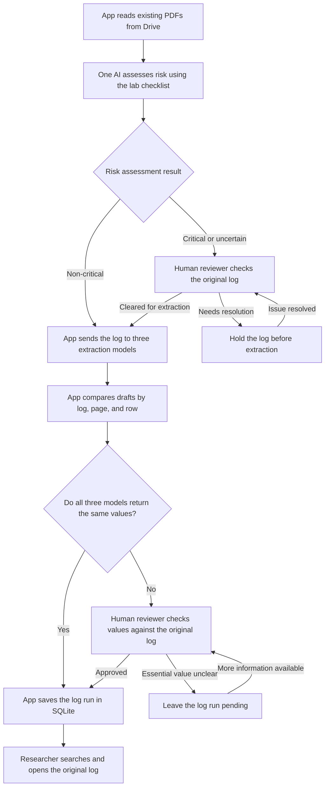

# Quantum Materials Lab — Growth Log Archive Design

**Draft for lab review** · Version 0.5 · November 8, 2026

**Scope** · Automated processing of existing Drive logs, followed by a pilot with in-app photo uploads

## 1. Problem and outcome

A researcher looking for a past log run may have to open several handwritten growth logs and cross-reference a JC number, date, compound, or furnace cycle. A log run is one crystal growth experiment documented in a paper log. One log can contain several log runs. Some older log runs lack a JC number or use a short suffix.

The MVP succeeds when a researcher can look up an imported log run by name, date, or JC number and open the original log at the relevant page and row while offline. The shared app should make the full archive the researcher is authorized to access available offline after a complete sync.

**The later pilot adds photo uploads.** Researchers take a photo of a paper log and submit it in the app. The app handles PDF conversion, file checks, and submission tracking through extraction and review.

The MVP uses the existing Drive PDFs. The app reads the logs from Drive, uses one AI to assess risk, and sends eligible logs to three extraction models. For each run, the extraction draft includes the researcher’s name, date, JC number if present, and composition as written, including any recorded ratios or weights. It points to the page and row in the original log and marks anything missing or unclear. When all three models return the same values for a log run, it goes straight into SQLite. A human reviewer checks disagreements and unresolved issues against the original log.

## 2. Status

- **[Drive inventory](https://drive.google.com/drive/folders/1q7wCJ1IxHwI8ItlhNOxSp9ZoZWkbgrn5).** Folder 1 has 152 prepared PDFs and folder 2 has 203, for 355 files. The archive addresses follow `log-1-###.pdf` and `log-2-###.pdf`. The filename index maps each address to its original file and Drive ID. A file address identifies a scan. A JC number is an optional identifier written on a run.
- **How the paper logs were scanned.** We sorted the logs into two groups. Paper logs that could feed safely through the UW paper scanner were scanned in batches grouped by log binder number. The resulting PDFs were then split into one PDF per page. Paper logs with tape or sticky notes that could catch in the scanner were photographed with Adobe Scan. The 30 repaired Adobe PDFs preserve 35 page images and rendered without the original decoding errors. Some logs contain several runs, and a run may span several pages in the original log.
- **Extraction and storage.** [Run 01](../pilot/runs/chatgpt/pdf-to-json/run01/README.md) is an unvalidated ChatGPT transcription of JC1301–JC1303. A local SQLite walkthrough stages and searches those three rows and demonstrates a reversible correction. These artifacts provide a starting point for the pilot.

## 3. MVP decisions and trade-offs

1. **Read the organized collection directly from Drive.** Connect the app to the two archive folders with read access. Use the filename index and Drive file IDs to track what has already been processed. Keep the original PDFs in Drive and use SQLite for review and offline search.
2. **Use `import-lab-records` for risk assessment.** For the first walkthrough, one model applies the lab's checklist through this Codex skill and returns a risk tier, a reason, and the relevant location in the original log. Critical, uncertain, or failed assessments go to human review. Non-critical logs move to the separate three-model extraction step. Measure how often the risk model misses critical issues before considering another.
3. **Use three models for extraction.** Give each model the same eligible PDFs, instructions, and JSON format. Import log runs directly when all three models return the same values for the same log run. Route disagreements, missing runs, and unresolved critical issues to a human reviewer.
4. **Preserve the drafts and import decision.** Keep the three drafts and record whether import followed model agreement or human review. If a person changes a value, save the revision and review decision. An identical retry can reuse the existing decision.

**Start with a reusable Codex skill.** Prototype `import-lab-records` outside the archive app. Give it the lab's risk checklist and use the [Run 01 prompt](../pilot/runs/chatgpt/pdf-to-json/run01/pdf-to-json-v1.text) as the starting point for the extraction instructions. The skill reads a supplied PDF, writes the risk decision and evidence, and can produce a separate JSON draft for an eligible log. Preserve the original PDF and flag unclear values. Use the lab's current field rules for the new drafts, and treat the Run 01 output as an example while the JSON format is being confirmed. The app owns comparison, review decisions, and SQLite import.

**First run without an API.** Run risk assessment with `import-lab-records` in Codex. Send eligible logs through GPT-6 Sol, Claude Sonnet 5, and Grok 4.6 in Purple ONEchat for extraction. Save the model name, prompt version, and JSON from each run. The local app accepts those outputs in the same format it will accept from an API later. The skill and Purple run outside the app and use an internet connection. Once the PDFs and outputs are downloaded, comparison, review, import, and search can run locally.

**Model access for automation.** The target is for the app to read Drive and start the model runs automatically. Purple currently provides no API keys, and the project has no confirmed model API credentials or budget. Confirm an approved endpoint, PDF support, and who pays for usage before adding unattended model calls. Keep the same risk, comparison, and review rules when moving from saved JSON to API responses. [UW Purple release notes](https://uwconnect.uw.edu/it?id=kb_article_view&sysparm_article=KB0037881) · [UW Purple FAQ](https://uwconnect.uw.edu/it?id=kb_article_view&sysparm_article=KB0035982)

## 4. Workflow and ownership

This Mermaid flowchart shows the target automated Drive workflow and where a human reviewer makes a decision. The first version can test the same decisions with saved JSON from the skill and Purple. SQLite and downloaded copies of the original logs stay available offline.

1. **App reads the existing PDFs from Drive.** Use the inventory to find the logs and keep their Drive file IDs with the extracted data.
2. **One AI assesses each log's risk.** Apply the lab's checklist to the original log and save the tier and evidence. Critical or uncertain logs stay on hold until a human reviewer clears them for extraction. If any run in a PDF has a critical issue, hold the PDF for review.
3. **App runs three extractors on eligible logs.** Submit the same PDF and instructions to all three models. Save each JSON draft with its model and version. Compare by log file, page, and row to flag missing runs and conflicting values.
4. **Human reviewer checks flagged log runs.** If the models disagree or one misses a run, the reviewer checks the original log. They approve the run if they can confirm the values or leave it pending if an essential value is unclear. The app saves the reviewer, date, and reviewed version.
5. **App saves log runs to SQLite.** When all three models return the same values for a run, the app saves it directly. A flagged run is saved once the human reviewer approves it. The app records how each run was accepted. Researchers can search by name, date, or JC and open the original log at the relevant page and row.

The app handles Drive intake, model calls, comparison, and import. The human reviewer handles risk clearance and extraction disagreements.

## 5. Log run fields and scientific boundaries

**Basic variables.** The lab confirmed the recorded date, JC number when present, and stoichiometry, including written ratios, before the pilot. Researcher name is proposed for search. Capture measurements when they are recorded, and use start or end timestamps as supporting evidence when the date is missing. Ask the lab to confirm which missing or ambiguous values block import and which can remain unresolved.

| Field group | Capture | Critical |
| --- | --- | --- |
| Identity | Researcher name, written JC, and confirmed full JC where known | A suffix could match more than one run, or JC order conflicts with date order |
| Date | Day or month precision as written. Keep timestamp evidence if used to infer a date | The header is blank and timestamps conflict or imply different months |
| Composition | Formula, ratios with component order, weights and units, and separate calculated and measured values. | An overwritten digit, unclear element symbol, or unknown ratio basis changes how the stoichiometry could be read |
| Furnace program | Optional source note for the written program or a pointer to the graph | — |
| Technique and layout | Optional source note for the written technique, transport agent, or layout drawing | — |

Search by name, date, and JC as written. Display the raw composition with the search result. Record furnace, technique, layout, measurements, and timestamps as source notes when present. Detailed furnace parsing and automated technique classification can wait. Leave load outside the required pilot fields. Preserve the difference between an inspected blank, an unreadable entry, an ambiguous reading, an inferred value, and a value omitted by the extractor. A known partial JC remains searchable as written. For log runs with the same date and no confirmed JC, use researcher name and stable log run ID to break ties.

A transport agent and labeled simultaneous furnace zones can support CVT. A high charge ratio, cooling program, and terminal decant can support flux growth. Record the evidence and route ambiguous cases to a researcher.

### Risk tiers for human review

- **Critical · Review before extraction.** Use this tier when an issue could attach data to the wrong run or change the scientific meaning of a core field. Examples include an uncertain row, a conflicting JC number, or an ambiguous compound, ratio, or unit. A human must clear the log before the app sends it to the three extractors. If a critical issue first appears in an extraction draft, resolve it before importing the affected run. A visibly absent JC number is valid if the original log identifies the run.
- **Non-critical · Send to extraction.** Use this tier for optional details that can remain unknown without changing the core values for that log run, such as a missing layout note or an unclear optional timestamp. Keep the uncertainty visible in the draft. If a timestamp is the only evidence for a date the log run depends on, review it as a critical issue.

These tiers are proposed for the lab to confirm using real logs before the pilot. Review a missing JC number, an ambiguous composition or unit, and a missing optional measurement together. Record which cases block AI evaluation or import, and use those decisions in the pilot's review checklist.

## 6. Local storage

Keep the PDFs in approved Drive storage. The import packet carries a stable log run ID, source file/page/row, written values, any confirmed normalized values, and the reason it was accepted. SQLite stores the searchable fields, source reference, and whether the values passed by model agreement or human review. A JC number may be missing or partial, so use the internal log run ID as the key.

**Offline use in the MVP.** Before disconnecting, put the SQLite database, the local search tools, and every original log PDF in the pilot collection on the laptop. Store a local file reference alongside the Drive reference so search results can open the source without a connection. The operator can also import a reviewed packet already on the laptop. Drive retrieval and cloud extraction wait until the connection returns.

Import a batch in one transaction. A malformed packet should leave the database unchanged. An identical reimport should create zero new rows. A changed packet for an existing log run should surface a conflict for the operator. Keep scans, private links, imported research data, and database files out of Git.

## 7. MVP acceptance checks

Check the risk model's decisions against a human reviewer's decisions on the same logs. Track critical logs the model incorrectly marks non-critical and non-critical logs it unnecessarily sends to review. Use Run 01 as an extraction baseline and have a human reviewer establish the expected rows and values for the logs used in testing.

Once the lab has confirmed the review rules and checked the expected values against the original logs, compare each extractor's draft against those values. Report critical and non-critical errors separately, including missed rows, and track the time spent preparing, comparing, and reviewing the drafts. On the same logs, check which additional errors the three-tool comparison flags compared with reviewing one draft. Reserve a few pages to check the result after the instructions are fixed. If extraction fails or the original log cannot support a critical value, keep that log run out of the import until the issue is resolved.

For the first walkthrough, use saved JSON to test model agreement, disagreements, and the SQLite import. With approved model API access, the automated MVP is ready when the team can:

- Read existing PDFs from Drive and assess risk without someone uploading each log.
- Send a non-critical log directly to the three extractors. Verify that a critical or uncertain log is held until a human clears it.
- Verify that three matching drafts go straight into SQLite. Return conflicting drafts or omit a run in one draft and verify that the affected run goes to human review.
- Find a known run by name, date, or JC and open the original log at the relevant page and row.
- Keep a missing or partial JC exactly as recorded.
- Hold a row with an unresolved critical issue and import a reviewed row with an optional detail marked unresolved.
- Retry the same import without duplicating database entries and see a clear error for an invalid or conflicting packet.
- Disconnect the laptop and reopen the local tools. Search the pilot log runs and verify that every original log PDF in the pilot collection opens without a connection.

## 8. After the MVP

**Researcher photo-upload pilot.** Researchers take a photo of a paper log and upload it in the app. The app checks that the whole log is readable, converts it to PDF, and verifies that every page renders. It asks for a retake if the photo is blurry or cropped. After upload, the app shows submission status and carries the PDF through the same extraction, review, and import workflow tested in the MVP.

**Reuse the processing workflow.** Once an uploaded photo becomes a PDF, send it through the same risk assessment, extraction, comparison, review, and import steps used for the existing Drive logs.

**Offline archive access.** Sync the full authorized archive to the device, including the searchable log runs and their original logs. Show when the download is complete and when it last synced. Keep the last complete copy usable if a refresh is interrupted. A researcher can still browse and open the downloaded archive while new uploads and updates wait for a connection.

**Offline photo capture.** Save the photo on the device when the connection drops and show it as pending. Upload and start extraction after reconnecting. Keep the pending photo until the archive confirms the PDF was saved and passed its rendering check. Use the same submission ID for retries to avoid duplicates. Test by taking a photo offline, reopening the capture screen, and reconnecting.

Before rolling this out, confirm who handles exceptions and which fields need review on every log run. Test on actual phone photos, including pages with several runs and notes in the margins. Measure both the time researchers spend submitting a log and the time reviewers spend checking it. Use those results to decide which fields can move to spot checks.

Meanwhile, instrument data lives on lab computers and Dropbox, and some files are also shared in Slack. Those overlapping digital sources can be reconciled later.
